# ЛР2. Вычислительные сервисы. Amazon EC2 (TimeCapsule)

- ФИО: Борденюк Иван (Bordeniuc Ivan)
- Группа: I2402
- Специальность: Informatică
- Уровень: продвинутый (Часть 1 + Часть 2, задания 1-14)
- Приложение: TimeCapsule, `open_capsules_php_functional`
- Вариант деплоя: B, скрипт [`deploy.sh`](deploy.sh), запуск с ноутбука по SSH
- Репозиторий: https://github.com/srulimoisovich-cloud/timecapsule (публичный)
- ADR: [0001. Деплой одной командой по SSH](docs/adr/0001-deploy-method.md)

Репозиторий и README приложения: [docs/APP_README.md](docs/APP_README.md).

## Коротко

Поднял один `t3.micro` с Amazon Linux 2023 в default VPC, зашёл по SSH, выложил три статические страницы через `scp`. Во второй части поставил на ту же машину nginx, PHP-FPM 8.4 и PostgreSQL 16, взял TimeCapsule из своего репозитория и научил сервер обновляться командой `ssh ... ./deploy.sh`. Дальше выкатил новую версию, нарочно сломал `views/layout.php`, откатил через `git revert`. Всё сделано в `eu-central-1`, под IAM-пользователем, не под root. Машина в конце остановлена. Расход: порядка 0.05 USD за часа работы t3.micro и 8 GiB EBS, списывается из кредитов free plan (в Billing за сегодня ещё не отразился).

Что где: терминал на скриншотах нарисован из реального вывода команд (пути чуть сокращены: `~/timecapsule` вместо реальной папки), AWS показан настоящей консолью в Chrome, номер аккаунта закрашен.

| Ресурс | Значение |
| --- | --- |
| Регион | `eu-central-1` |
| Instance | `webserver`, `i-09557fc72787a3b07`, `t3.micro`, AL2023, зона `eu-central-1a` |
| Key pair | `ivanbordeniuc-keypair` (ED25519, `.pem`, `~/.ssh`, `chmod 400`) |
| Security group | `webserver-sg`: 22 с моего IPv4 (`/32`), 80 с `0.0.0.0/0` |
| Бюджет | `ZeroSpend` |
| IP | часть 1: `3.75.248.185`, после Stop/Start: `3.71.173.15` |

---

## Часть 1. Базовый уровень

### Задание 1. Аккаунт

Работаю под IAM-пользователем `ivanbordeniuc_student` из группы `Admins` (политика `AdministratorAccess`), регион Frankfurt. Бюджет `ZeroSpend` создан по шаблону `Zero spend budget`. В аккаунте уже лежал автоматический `My Zero-Spend Budget`, я его не трогал и сделал свой по заданию.

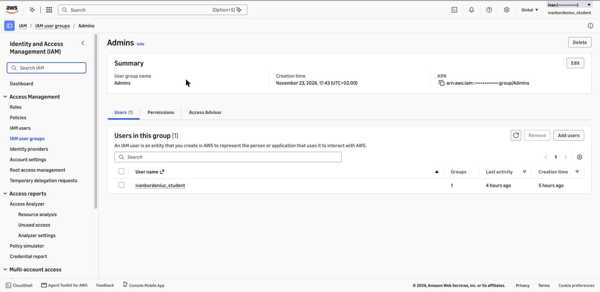
Группа `Admins`: в ней мой пользователь (слева), у группы политика `AdministratorAccess` (второй кадр, `lab2-iam-admins-perms.jpg`).

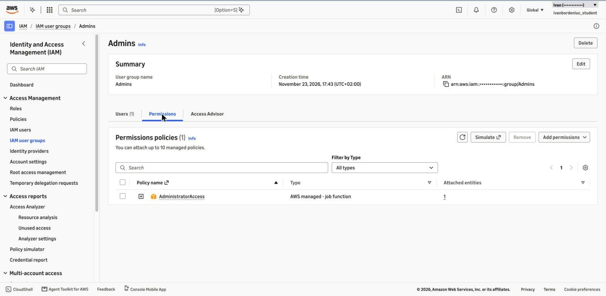

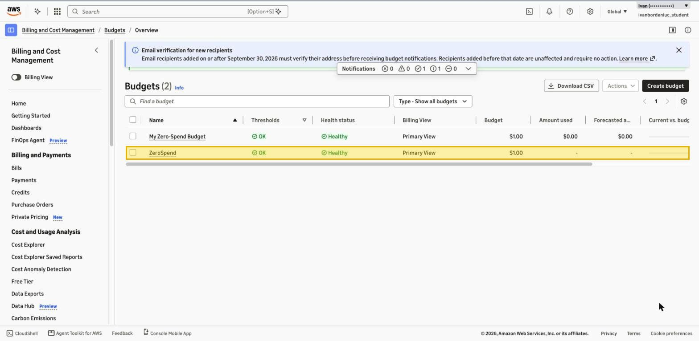
`ZeroSpend` в списке `Budgets`, статус OK.

ответ (Q01): `AdministratorAccess` это политика "всё на всё": любое действие над любым ресурсом аккаунта, кроме нескольких вещей, которые доступны только root (закрыть аккаунт, сменить план поддержки). Под root ходить нельзя, потому что у него нет ограничений и одна ошибка или утёкший пароль задевает весь аккаунт, а MFA на нём единственная защита. У IAM-пользователя права можно сузить, ключи отозвать, а само действие видно под конкретным именем.

### Задание 2. Запуск EC2

Ключ `ivanbordeniuc-keypair`, ED25519, `.pem`, положил в `~/.ssh`. Новая группа `webserver-sg`: SSH только с моего IPv4 `/32` (вариант `My IP` в консоли подставил IPv6, он бесполезен: у машины нет IPv6, поэтому выбрал `Custom`), HTTP со всех. User data ровно из задания.

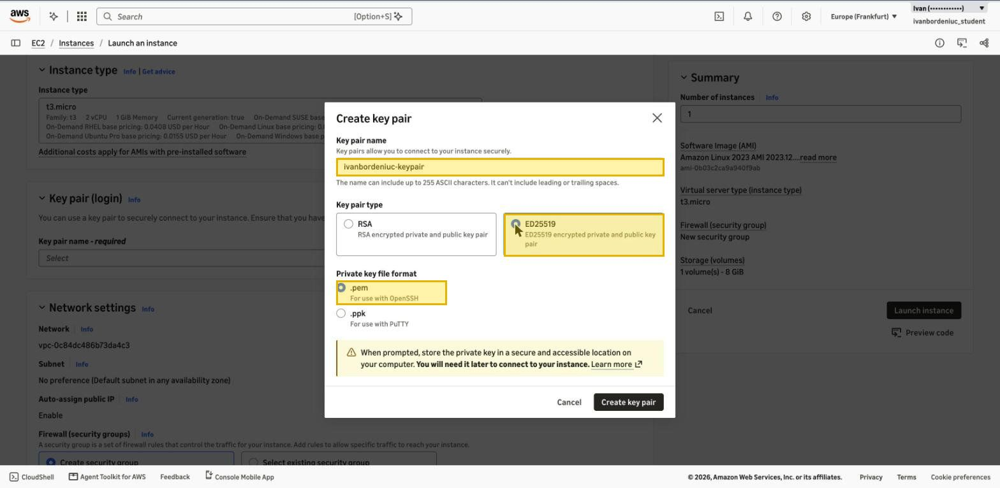
Окно создания ключа до нажатия Create: `ivanbordeniuc-keypair`, ED25519, `.pem`.

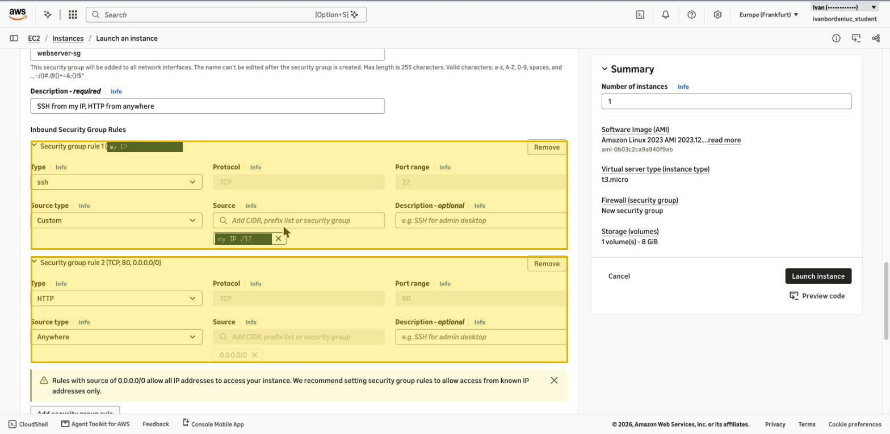
`webserver-sg`: SSH с моего IPv4 `/32` (адрес закрашен) и HTTP с `0.0.0.0/0`.

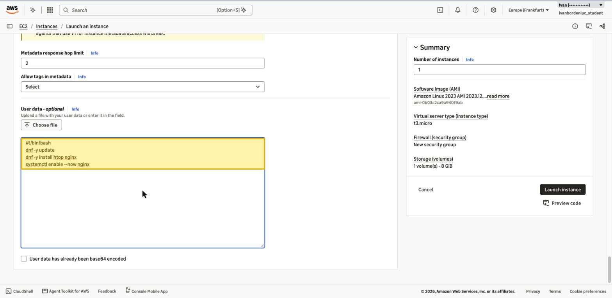
`Advanced details`, поле User data со скриптом из задания.

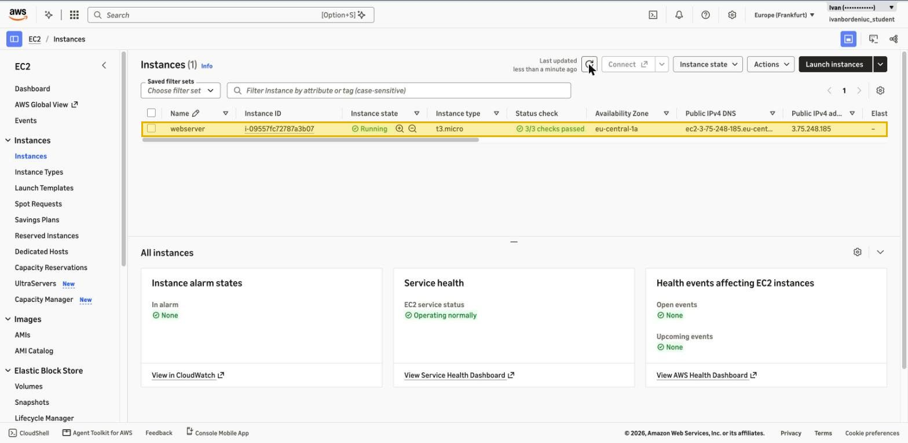
`webserver` в `Running`, в колонке `Status check` проверки пройдены (в новой консоли их три: `3/3 checks passed`), виден ID и публичный IP.

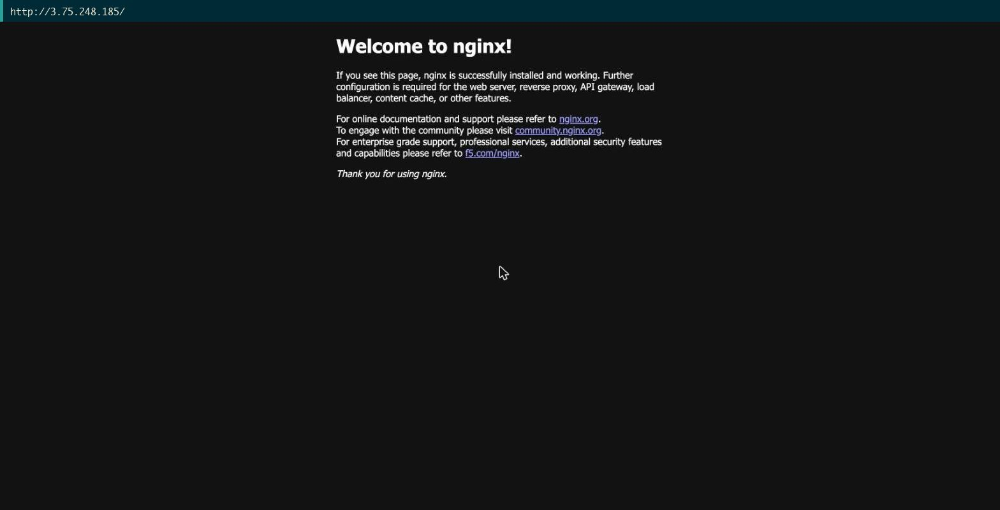
приветственная страница nginx по `http://3.75.248.185/`.

ответ (Q02): User data это скрипт, который cloud-init выполняет от root при самом первом запуске экземпляра, чтобы машина сама себя настроила. После обычной перезагрузки он повторно не запускается, только если вручную не включить это в cloud-init. После Stop/Start тоже не запускается.

### Задание 3. Мониторинг и диагностика

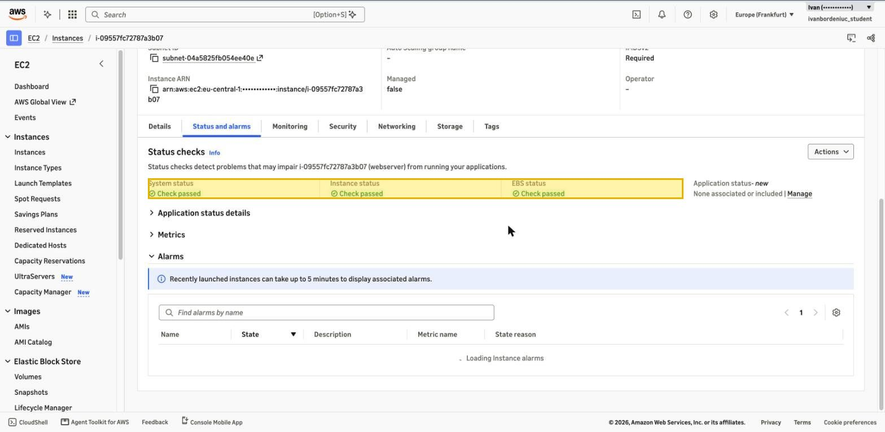
`Status and alarms`: System, Instance и EBS пройдены.

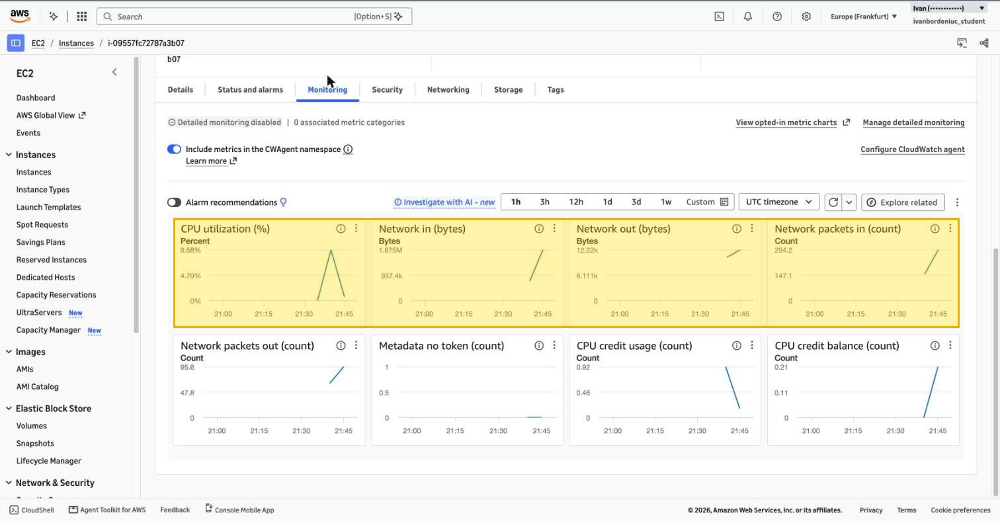
вкладка `Monitoring`, графики CPU и сети.

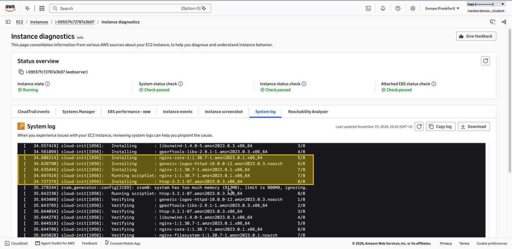
фрагмент `System log` со строками установки `nginx` и `htop` из user data.

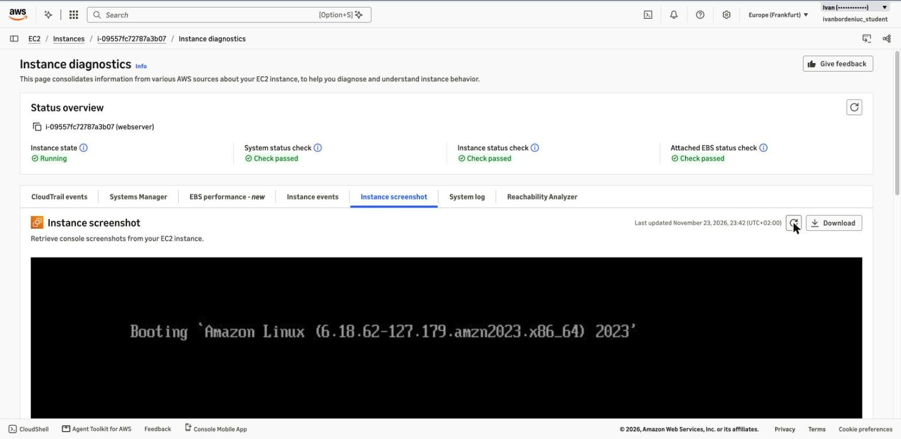
`Instance screenshot`: консоль машины показывает строку загрузчика, дальше экран не меняется (у AL2023 без графики так и должно быть).

ответ (Q03): Если сломалась сама машина (ядро не загрузилось, ОС не отвечает), это `Instance status check`, и починить это можно самому. `System status check` показывает проблему железа или сети AWS, там можно только ждать или сделать Stop/Start, чтобы экземпляр переехал на другой хост. `Attached EBS` следит за доступностью дисков.

ответ (Q04): Детальный мониторинг (раз в минуту) имеет смысл, когда нужно быстро реагировать на всплески: автоскейлинг, алармы по CPU, разбор коротких пиков. Для учебной одиночной машины хватает 5 минут, а детальный стоит денег.

### Задание 4. SSH

`chmod 400` на ключ, первое подключение с ответом `yes` на вопрос про fingerprint, дальше `systemctl status nginx`. Команда выполняется в виде однострочника, чтобы вывод был коротким.

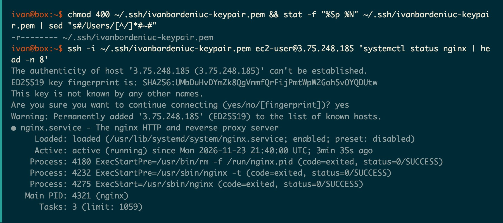
вопрос про fingerprint, `yes`, `nginx.service` в `active (running)` (терминал, реальный вывод).

ответ (Q05): Пароль можно подобрать или украсть фишингом, а закрытый ключ нигде не передаётся: сервер хранит только публичную половину и проверяет, что у клиента есть парная приватная. Ключ ещё и длиннее любого пароля и не уходит по сети.

### Задание 5. Статический сайт

Три страницы `index.html`, `about.html`, `contact.html`: яркий градиент, большие кнопки между страницами, без картинок. Копирую `scp`, потом на сервере `sudo cp` в `/usr/share/nginx/html/`.

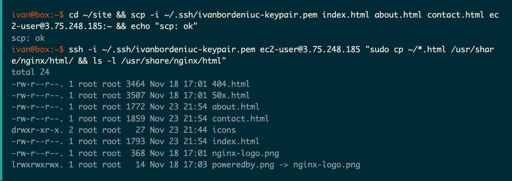
`scp` с ноутбука и `ls -l /usr/share/nginx/html` (владелец root).

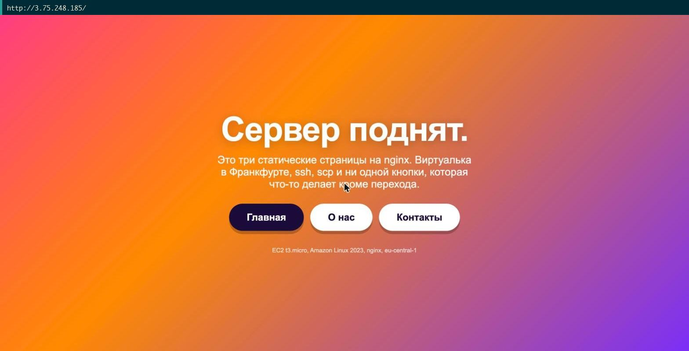
сайт в браузере, главная, IP виден в строке адреса над кадром.

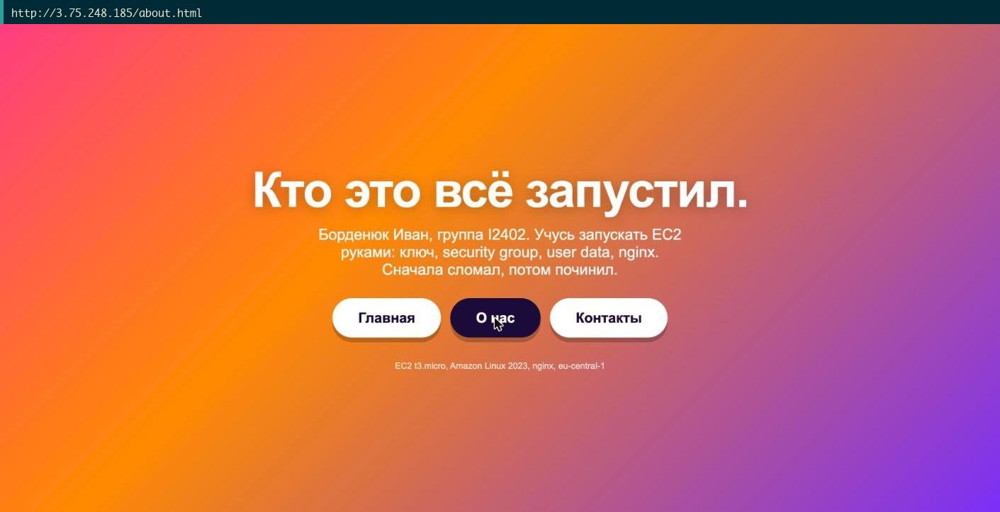
`about.html`, открылась по кнопке с главной.

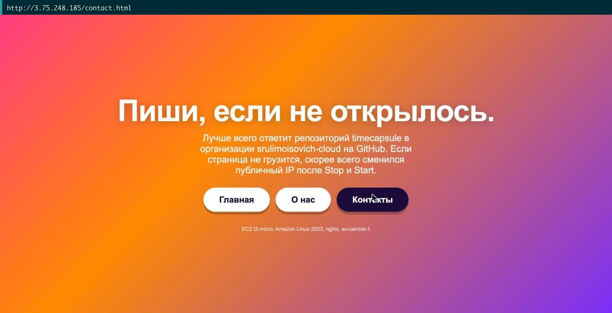
`contact.html`, открылась по кнопке со страницы `О нас`.

ответ (Q06): `scp` копирует файлы между машинами поверх SSH, с теми же ключом и пользователем, но вместо оболочки получается передача файлов. Адрес пишется так же: `user@host`, плюс путь на удалённой стороне после двоеточия. Выполнять его надо на своём компьютере, потому что копируешь с него.

### Задание 6. Остановка через CLI

Остановил машину с ноутбука, под профилем `ivanbordeniuc_student`.

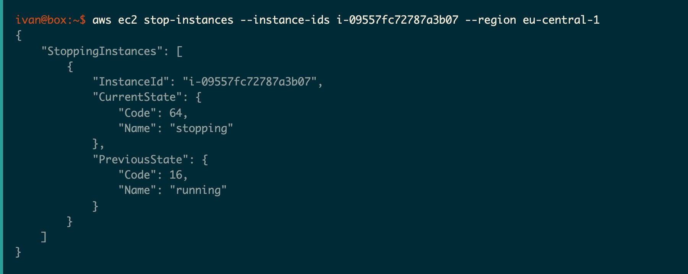
`aws ec2 stop-instances --instance-ids ... --region eu-central-1`, в ответе `stopping`.

ответ (Q07): `Stop` выключает машину, диск EBS и ID остаются, потом её можно запустить снова (публичный IP при этом сменится). `Terminate` удаляет экземпляр, а корневой диск по умолчанию удаляется вместе с ним. Пока машина остановлена, я продолжаю платить за EBS (и за Elastic IP, если он есть), за вычисления нет.

---

## Часть 2. Продвинутый уровень

### Задание 7. GitHub

Организация `srulimoisovich-cloud`, публичный репозиторий `timecapsule`. Код `open_capsules_php_functional` лежит в корне: видны `public`, `src`, `views`, `composer.json`. Репозиторий создан без README, `.gitignore` и лицензии от GitHub. Первый коммит: `import: TimeCapsule (open_capsules_php_functional) from app-samples`. Приложение принято как есть, README приложения перенесён в `docs/APP_README.md`, а отчёт ЛР2 лежит здесь, в корневом `README.md`, скриншоты в `docs/lab2/shots/`.

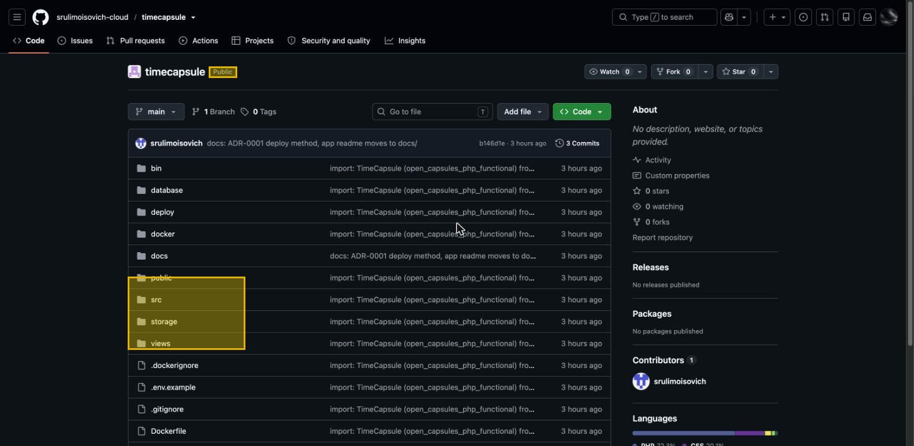
корень репозитория на GitHub: `public`, `src`, `views`, `composer.json`, репозиторий `Public`.

ответ (Q08): `vendor/` собирается командой `composer install` из `composer.lock`, поэтому хранить его незачем: он большой и воспроизводится. `.env` хранит пароль к базе и настройки сервера, а репозиторий публичный. Оба пути перечислены в `.gitignore`.

### Задание 8. Подготовка сервера

Запустил `webserver` заново (Start), взял новый IP. Поставил пакеты из задания, nginx уже стоял из user data.

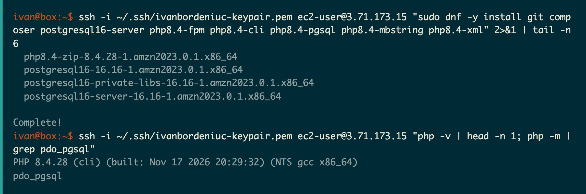
`dnf install ...` (хвост вывода), `php -v`, `pdo_pgsql` в списке модулей.

ответ (Q09): User data срабатывает один раз при первом старте и не показывает, что пошло не так. Руками видно каждую ошибку (нет пакета, не тот репозиторий) и можно сразу чинить. Когда состав пакетов устоится, его перенесут в готовый образ (AMI) или шаблон запуска, но это уже следующие лабы.

### Задание 9. PostgreSQL

`initdb`, `ident` -> `scram-sha-256` в `pg_hba.conf` через `sed`, пользователь и база `timecapsule`. Пароль сгенерирован локально, в отчёте его нет.

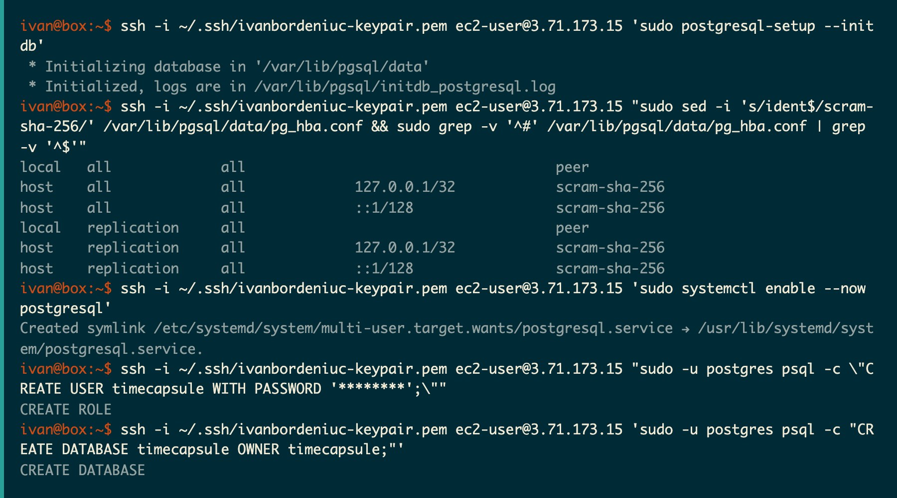
`postgresql-setup --initdb`, `pg_hba.conf` после правки, создание пользователя (пароль скрыт) и базы.

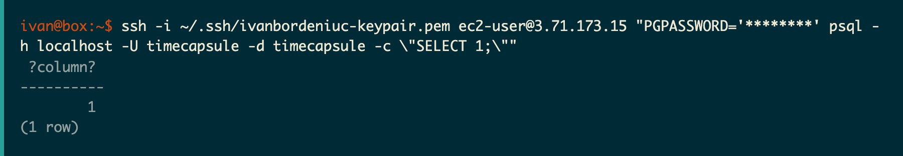
`psql -h localhost -U timecapsule -d timecapsule -c "SELECT 1;"`, пароль скрыт, в ответе `1`.

### Задание 10. Код на сервере

`git clone` по HTTPS без ключей, `.env` по шаблону из задания (`chmod 640`, группа `apache`, `storage` отдан `apache`), `composer install` и `php bin/init-db.php`.

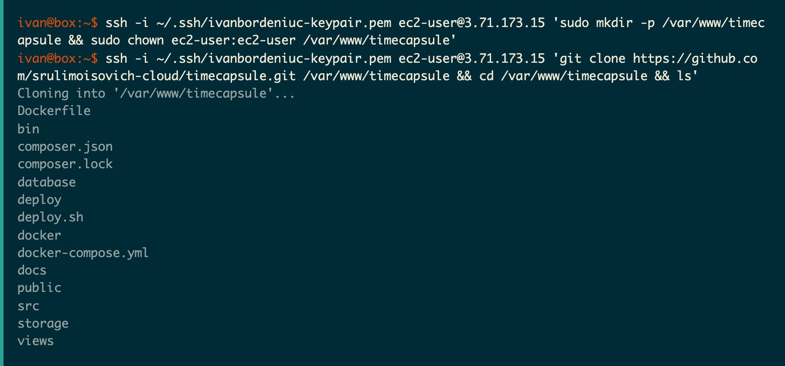
`git clone` и `ls` в `/var/www/timecapsule`.

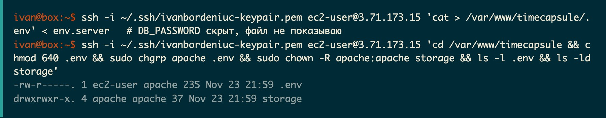
`.env` ложится на сервер (содержимое не показываю), права `640 ec2-user apache`, `storage` у `apache`.

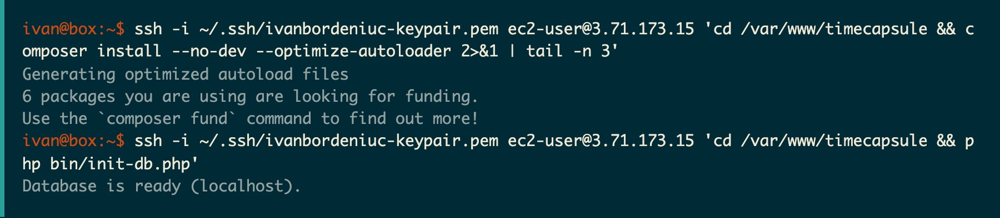
`php bin/init-db.php` печатает `Database is ready`.

ответ (Q10): Пароль в `.env` лежит только на сервере, права `640` и группа `apache` не пускают других пользователей, а `.env` игнорируется git и не уезжает в репозиторий. Публичный репозиторий безопасен, потому что в нём только код без секретов, а чтобы запустить его нужен свой `.env`. Скрытые файлы nginx вообще не отдаёт (`location ~ /\. { deny all; }`).

### Задание 11. PHP-FPM и nginx

`upload_max_filesize = 6M`, `timecapsule.conf` ровно по заданию, `nginx -t`, `php-fpm` включён, nginx перезапущен.

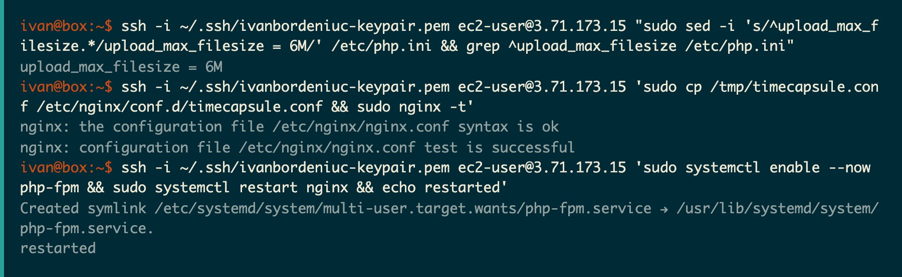
`upload_max_filesize`, `nginx -t` (`syntax is ok`, `test is successful`), запуск php-fpm.

Страницу входа в чистом виде не снял: в браузере уже была открыта сессия, а пароль вводил сам пользователь. Приложение отвечает, ниже `/health`; страница после входа есть в задании 13.

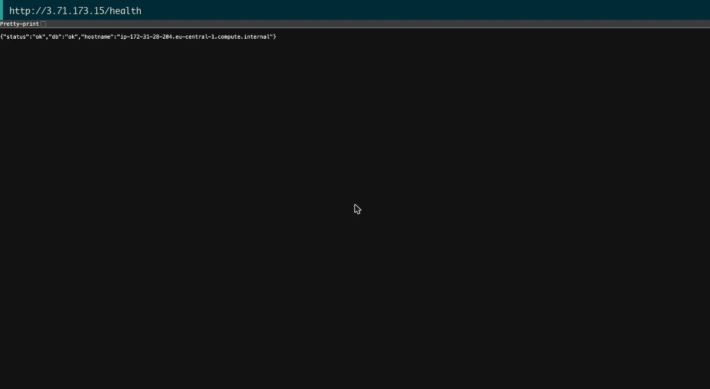
`/health` отвечает `{"status":"ok","db":"ok",...}`.

### Задание 12. deploy.sh

Выбрал вариант B (Informatică). Скрипт лежит в корне репозитория и скопирован на сервер как `~/deploy.sh`. К заданию я добавил последнюю проверку `curl -fsS /health`. Сначала запуск на самом сервере (должно быть `Already up to date`), потом тот же скрипт с ноутбука.

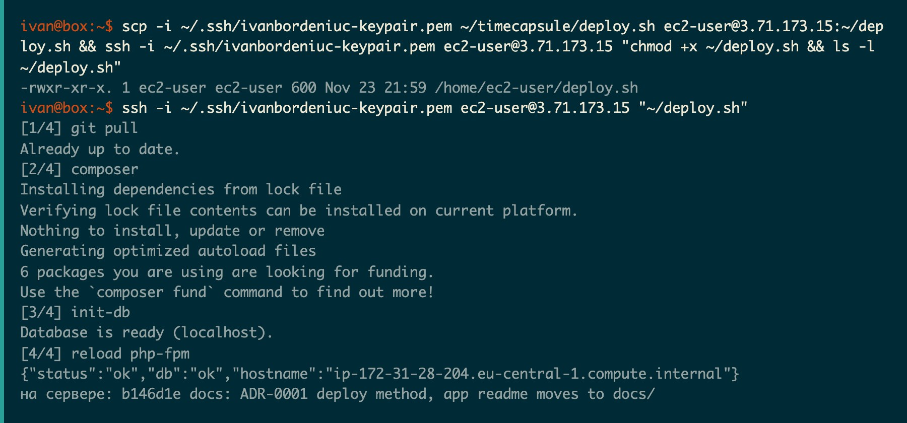
`deploy.sh` на сервере: `Already up to date`, последняя строка с коммитом.

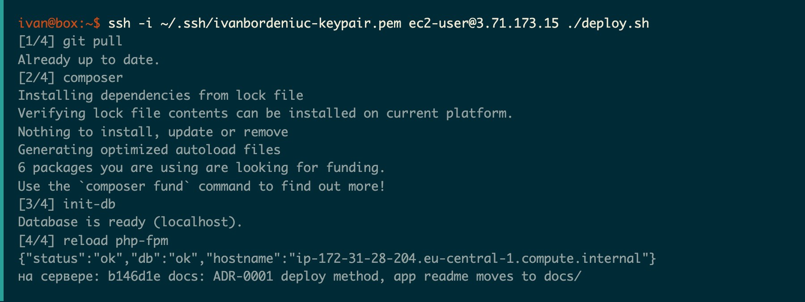
`ssh ... ./deploy.sh` с ноутбука, вывод тот же.

ответ (Q11): `git pull` заменяет файлы по очереди, пара секунд у посетителя может открыться страница из смеси старой и новой версий, вплоть до ошибки. Без `composer install` код может требовать библиотек, которых нет в `vendor/`, и сайт упадёт с ошибкой про отсутствующий класс или `vendor/ is missing`.

### Задание 13. Версия, поломка, откат

1. Регистрация и капсула с файлом: зарегистрировался в приложении сам (пароль вводил я), капсулу `Letter to my future self` с файлом `capsule-photo.png` создал через форму; запись есть в базе (`capsules`, id 1), файл лежит в `storage/uploads`.
2. Релиз: в подвале строка с моим именем, коммит `footer: show my name`, push, `./deploy.sh`. Капсула никуда не делась.
3. Поломка: в конец `views/layout.php` добавил `<?php if (`, коммит `layout: break it`, push, деплой. Страницы с шаблоном дают 500, `/health` отвечает `ok`.
4. Откат: `git revert --no-edit HEAD`, push, деплой. На сервере руками ничего не правил.

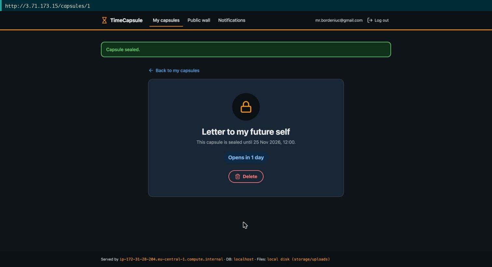
капсула запечатана (открытие 25 ноября), в списке у неё `1 file`; сам файл лежит в `storage/uploads` на сервере (3178 байт).

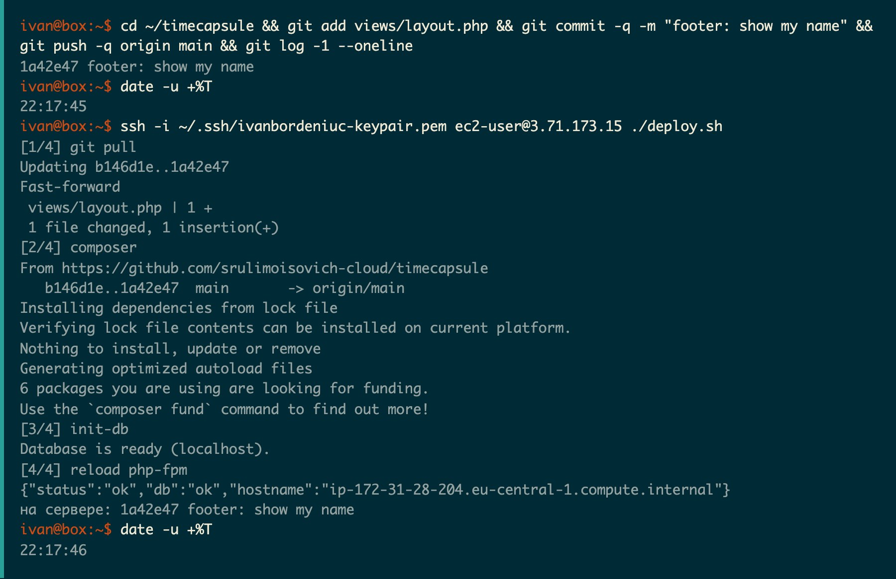
коммит, push и деплой новой версии (терминал, с `date -u`).

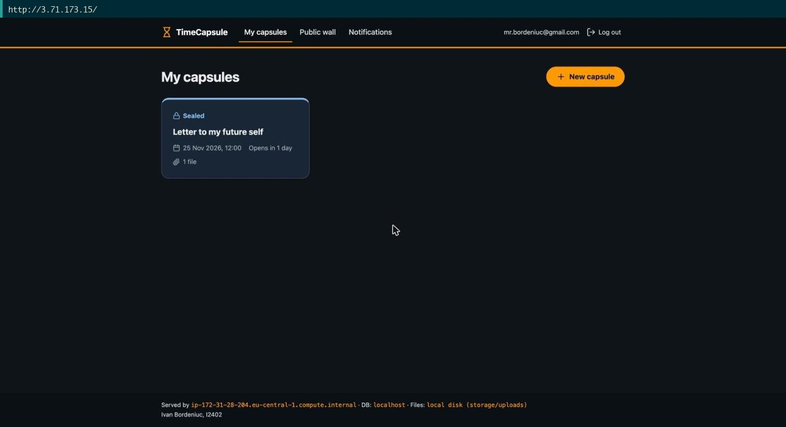
подвал с моим именем, капсула на месте.

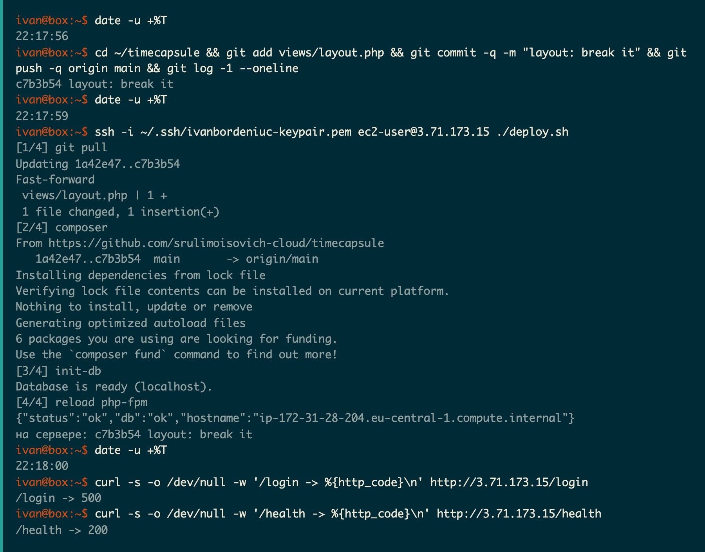
коммит и деплой сломанной версии; `/login` (страница с шаблоном, без входа) даёт `500`, `/health` даёт `200`.

главная в браузере при поломке: Chrome показывает свою страницу `HTTP ERROR 500`, инструмент съёмки её не снимает, поэтому вместо кадра есть код `500` в терминале выше.

`/health` при сломанной главной: `ok`.

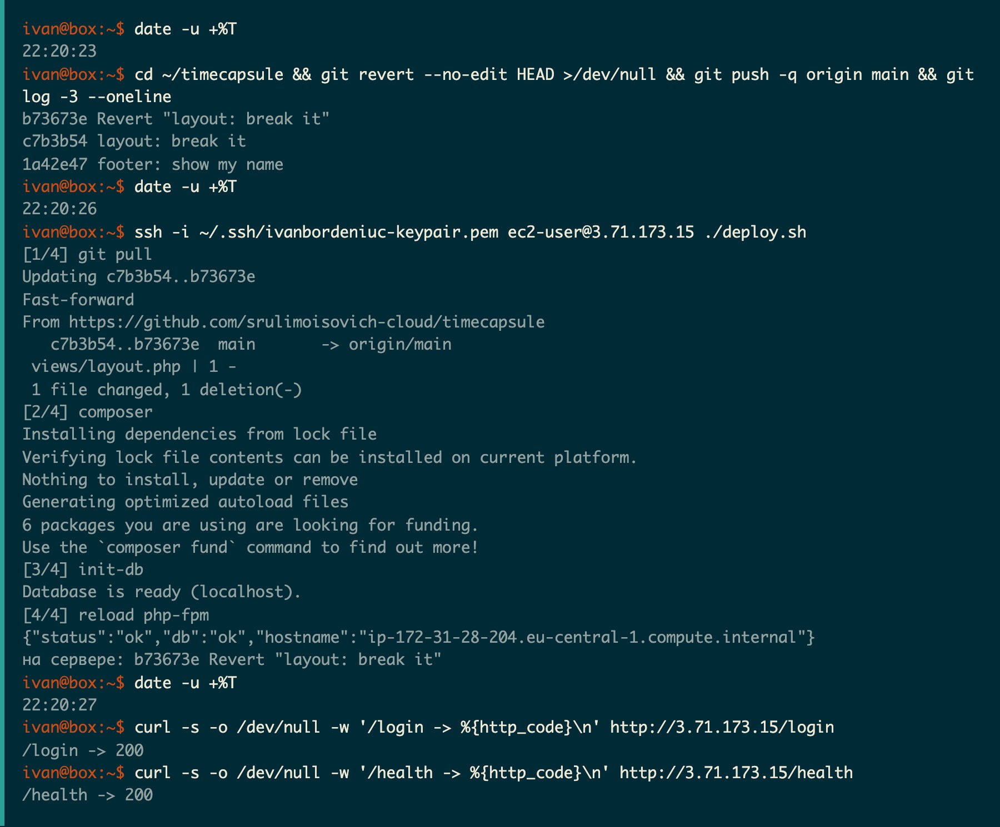
`git revert`, push, деплой, коды `200 / 200`.

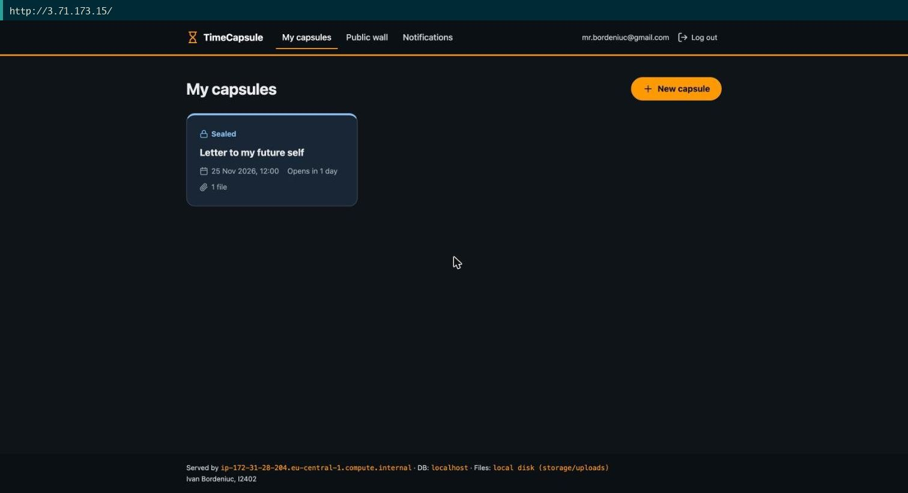
главная снова открывается, подвал без поломки.

ответ (Q12): `/health` проверяет только то, что PHP жив и база отвечает (запрос `SELECT COUNT(*) FROM users`), и вообще не рендерит шаблон `layout.php`, поэтому синтаксическая ошибка в нём его не задевает. Не хватает проверки самой страницы: хотя бы `curl` главной с проверкой кода 200 и куска текста. Хорошо ещё, чтобы деплой сам откатывался, если такая проверка не прошла.

ответ (Q13): сайт был сломан 2 мин 27 с (по `date -u`: деплой поломки закончился в 22:18:00, деплой отката закончился в 22:20:27). От начала push поломки (22:17:56) до конца отката прошло 2 мин 31 с. Из них: push поломки 3 с, деплой поломки 1 с, поиск и проверка (я смотрел `/health`, `/login` и главную в браузере и решал откатывать) 143 с, revert и push 3 с, деплой отката 1 с. Почти всё время ушло на человека, а не на выкатку. Сократить можно авто-проверкой главной в самом `deploy.sh` и автоматическим откатом на предыдущий коммит при неудаче.

### Задание 14. Схема и ADR

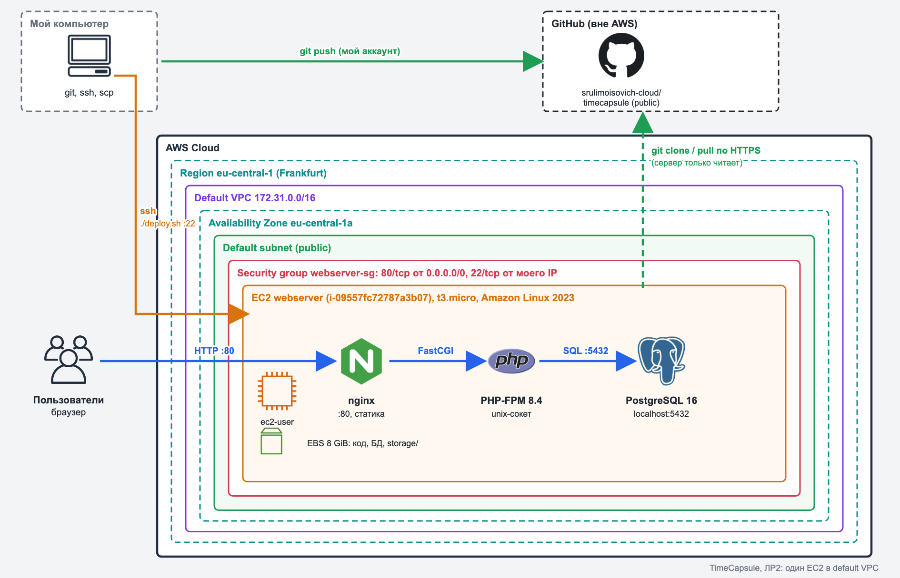
Схема развёртывания: пользователи по HTTP на nginx, AWS Cloud / `eu-central-1` / default VPC / зона / подсеть / `webserver-sg` / EC2 с nginx, PHP-FPM, PostgreSQL, GitHub вне AWS (сервер читает по HTTPS), ноутбук (`git push`, `ssh ./deploy.sh`). Без Internet Gateway, он пока не нужен.

ADR: [`docs/adr/0001-deploy-method.md`](docs/adr/0001-deploy-method.md). Сравнил `scp`, `git pull` руками, `deploy.sh` и CI/CD, выбрал `deploy.sh`.

### Завершение

`webserver` остановлен (`stopped`), не удалён.

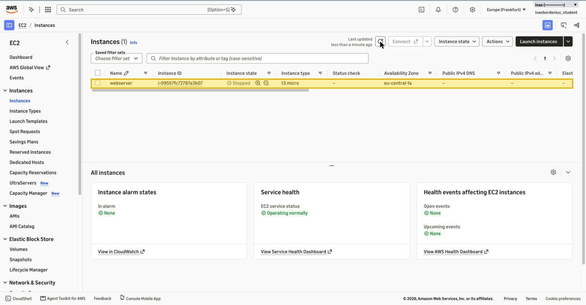
`Instances`, `webserver` в состоянии `Stopped`.

## Грабли

- Аккаунт пришёл с готовым `My Zero-Spend Budget`; `ZeroSpend` из задания создавал отдельно.
- В новой консоли EC2 у машины три проверки (`3/3 checks passed`), а не две, как в задании.
- Кнопка `My IP` в мастере подставила IPv6 браузера, а SSH с ноутбука идёт по IPv4, который узнаёт `curl -4 ifconfig.me`. Поставил `Custom` с адресом `/32`.
- Теги: в мастере поставил `Name` для Instances и Volumes, остальные шесть тегов и `Name` для SG добавил после запуска командой `aws ec2 create-tags` (в этом мастере у группы безопасности нет своего блока тегов).
- Первый `scp` я выполнил раньше, чем снял стартовую страницу nginx, и она затёрлась моим `index.html`. Вернул через `dnf reinstall nginx` и повторил `scp` после снимка.
- `Instance screenshot` показывает только строку загрузчика, дальше машина не рисует.
- Chrome отдаёт собственную страницу при HTTP 500, и инструмент съёмки такую страницу не снимает, поэтому 500 показан кодом из `curl`, а в браузере снят только `/health`.
- После Stop/Start IP другой: каждый раз пересчитываю `IP` в `env.sh`, а `APP_URL` в `.env` пришлось бы править руками; здесь Start был один раз, и `.env` писался уже под новый IP.

## Q&A (устные вопросы)

**1. Как проходит запрос от браузера до базы? Что делает каждая программа?**
Браузер идёт на порт 80, там nginx. Статику (css, js) он отдаёт сам, всё остальное передаёт в PHP-FPM через unix-сокет `/run/php-fpm/www.sock`. PHP-FPM запускает `public/index.php`, а тот ходит в PostgreSQL по `localhost:5432` и возвращает HTML обратно в nginx.

**2. Почему сервер читает репозиторий, но не пишет в него? Почему это правильно?**
Репозиторий публичный, поэтому `git clone` и `git pull` по HTTPS работают без логина. Для `push` нужна авторизация, а ключей на сервере нет. Это правильно: взломают сервер, код в репозитории всё равно не подменят.

**3. Что будет с загруженными файлами, если удалить EC2?**
Файлы лежат в `storage/uploads` на корневом томе EBS. Пока машина жива, том и файлы остаются даже после Stop. При Terminate корневой том по умолчанию удаляется вместе с экземпляром, и файлы пропадут вместе с базой. Поэтому позже вложения переедут в S3, а база в RDS.

**4. Что общего у `deploy.sh` и CI/CD? Чего не хватает?**
Суть та же: по команде берём код из репозитория, ставим зависимости, обновляем базу и перезапускаем сервис. Не хватает автоматического запуска по push, тестов перед выкаткой, проверки главной страницы после выкатки, автоматического отката и истории деплоев. Запускаю я руками с ноутбука, а он должен работать и когда его нет.

## Итог

Остановлено: `webserver`. Ничего платного не запущено: ни NAT, ни Elastic IP, ни RDS. EBS 8 GiB остаётся (в пределах free plan).

## Ссылки

- Лекция 4 и Hands-on 4.1-4.3 курса
- Репозиторий с примерами: https://github.com/msu-cloud-course/app-samples
- Документация: Amazon EC2 User Guide, раздел про user data и status checks
