# ЛР3. Облачные сети. Amazon VPC (TimeCapsule)

- ФИО: Борденюк Иван (Bordeniuc Ivan)
- Группа: I2402
- Специальность: Informatică
- Номер в группе: `k = 3`, `X = 3 % 30 = 3`, сеть `10.3.0.0/16`
- Уровень: продвинутый (Часть 1 + Часть 2, задания 1-14)
- Репозиторий: https://github.com/srulimoisovich-cloud/timecapsule (публичный)
- Вариант NAT: B, скрипты [`scripts/nat-up.sh`](../../scripts/nat-up.sh) и [`scripts/nat-down.sh`](../../scripts/nat-down.sh)
- ADR: [0002. База за bastion, без публичного адреса](../adr/0002-database-placement.md)
- Отчёт ЛР2: [README.md](../../README.md) в корне репозитория

## Коротко

Собрал сеть `timecapsule-dev-vpc` (`10.3.0.0/16`): четыре подсети в двух зонах, Internet Gateway, две таблицы маршрутов, три Security Group. Поднял `bastion`, `web` и `db`, зашёл на них только через `ProxyJump`, поставил PostgreSQL на `db` во временном NAT и убрал NAT. Потом перенёс приложение из ЛР2: образ, `app` из образа, Elastic IP, приватная зона `timecapsule.internal`, `pg_dump` в новую базу, старый PostgreSQL выключен. Выкатил версию с "LR3" в подвале, уронил `db` и посмотрел, как приложение оживает само. Расход небольшой: два NAT по несколько минут (центы), постоянно платят только Elastic IP `app` и зона Route 53. Все экземпляры в конце остановлены.

Как сняты рисунки. Ресурсы созданы AWS CLI с тегами, консоль AWS показана настоящими снимками из Chrome (аккаунт и домашний IP закрыты плашками). Терминал нарисован из реального вывода команд, команды выполнялись с ноутбука через `bastion` (`ssh web`, `ssh db`, `ssh app`). Мой SSH-конфиг лежит в отдельном файле лабы и подключается через `-F`, потому что в общем `~/.ssh/config` уже сидят чужие `Host bastion`. Домашний IP в тексте `89.149.x.x`.

| Ресурс | Имя | ID / адрес |
| --- | --- | --- |
| VPC | `timecapsule-dev-vpc` | `vpc-0598ca6f94a356e46`, `10.3.0.0/16` |
| Internet Gateway | `timecapsule-dev-igw` | `igw-0a233c47de5e80aaf` |
| Таблицы маршрутов | `timecapsule-dev-public-rt`, `timecapsule-dev-private-rt` | `rtb-0b7b7bb9f8c8ab785`, `rtb-0ddf838897b87f96f` |
| Security Group | `timecapsule-dev-bastion-sg`, `-web-sg`, `-db-sg` | `sg-096252524b4f0e4b7`, `sg-059f682bab0038dc9`, `sg-01f72b2eed9463820` |
| bastion | `timecapsule-dev-bastion` (`public-b`) | `i-0b28133fbf8d63133`, `10.3.1.92` |
| web (Часть 1) | `timecapsule-dev-web` (`public-a`) | `i-0f6a0dc5ee1c6fdcf`, `10.3.0.206` |
| db | `timecapsule-dev-db` (`private-a`) | `i-0b62c045ddb75436f`, `10.3.10.207` |
| app | `timecapsule-dev-app` (`public-a`) | `i-09893182f9f2aa016`, `10.3.0.102` |
| Elastic IP | `timecapsule-dev-app-eip` | `3.122.199.17` |
| Приватная зона | `timecapsule.internal` | `Z0351382303UUTZTWYN4D`, `db` A `10.3.10.207` |

Теги на всём: `Name`, `Project=timecapsule`, `Environment=dev`, `Owner=ivanbordeniuc`, `Lab=lab3`, плюс мои `Team=solo` и `Stack=php`. Диски экземпляров и снимок образа с тегами.

---

## Часть 1. Базовый уровень

### Задание 1. План адресов

| Подсеть | Зона | Диапазон | Первый и последний адрес для экземпляров | Сколько |
| --- | --- | --- | --- | --- |
| `public-a` | `eu-central-1a` | `10.3.0.0/24` | `10.3.0.4` - `10.3.0.254` | 251 |
| `public-b` | `eu-central-1b` | `10.3.1.0/24` | `10.3.1.4` - `10.3.1.254` | 251 |
| `private-a` | `eu-central-1a` | `10.3.10.0/24` | `10.3.10.4` - `10.3.10.254` | 251 |
| `private-b` | `eu-central-1b` | `10.3.11.0/24` | `10.3.11.4` - `10.3.11.254` | 251 |

ответ: 256 минус 5 служебных. AWS забирает в каждой подсети `.0` (адрес сети), `.1` (маршрутизатор VPC), `.2` (DNS-сервер VPC, база + 2), `.3` (резерв на будущее) и `.255` (broadcast; в VPC он не работает, но адрес всё равно занят). В `/16` помещается 256 подсетей `/24`, четыре заняты, ещё 252 свободны.

### Задание 2. VPC и подсети

Создал VPC `10.3.0.0/16` без IPv6, включил `DNS resolution` и `DNS hostnames`, создал четыре подсети из таблицы. Мелочь: main route table, default NACL и default SG у VPC без имени, их я тоже подписал и затегал (`timecapsule-dev-main-rt`, `-default-nacl`, `-default-sg`), чтобы Tag Editor показал всё.

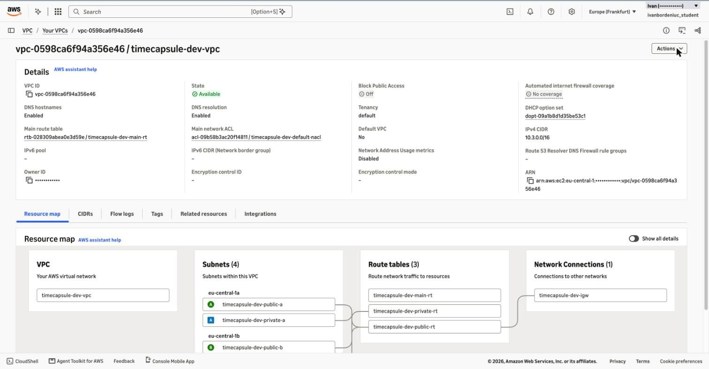

VPC `timecapsule-dev-vpc`, `10.3.0.0/16`, DNS resolution и hostnames включены.

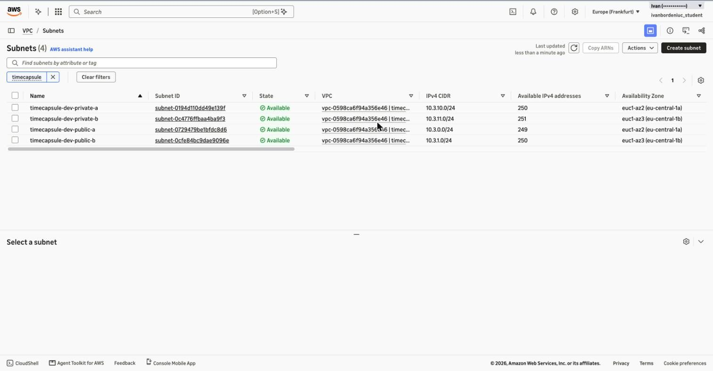

Четыре подсети с CIDR и зонами.

ответ (публична ли `public-a` сразу): нет. Подсеть публична не из-за имени, а из-за маршрута `0.0.0.0/0` в Internet Gateway, а сразу после создания она сидит на main route table, где есть только `local`. К тому же IGW ещё не существует.

### Задание 3. Internet Gateway и таблицы маршрутов

IGW `timecapsule-dev-igw` создан и подключён (`Attached`). `public-rt`: `0.0.0.0/0` -> IGW, связи `public-a` и `public-b`. `private-rt`: без новых маршрутов, связи `private-a` и `private-b`. На `public-a` и `public-b` включил `auto-assign public IPv4`.

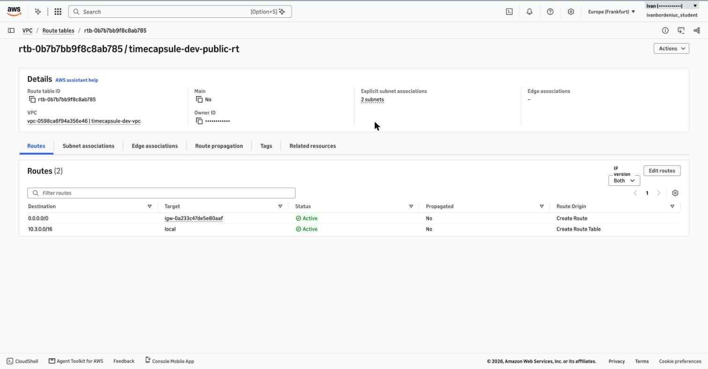

`public-rt`: `0.0.0.0/0` -> IGW, две подсети.

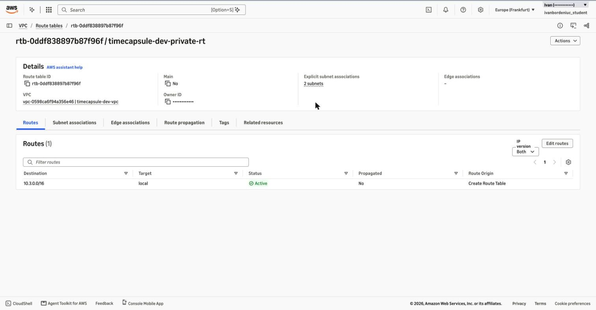

`private-rt`: только `local`, две подсети.

ответ: в обеих таблицах есть `10.3.0.0/16 local`. Он даёт связь между любыми адресами внутри VPC без шлюзов и удалить его нельзя. Пакет на `8.8.8.8` из `private-a` уходить некуда: в `private-rt` нет ничего, кроме `local`, и он отбрасывается (а когда в таблице стоит маршрут на удалённый NAT, это `Blackhole`).

### Задание 4. Security Group

Три группы в `timecapsule-dev-vpc`, у каждой описание и тег `Name`: `bastion-sg` (22 с моего IP `/32`), `web-sg` (80 с `0.0.0.0/0`, 22 от `bastion-sg`), `db-sg` (5432 от `web-sg`, 22 от `bastion-sg`).

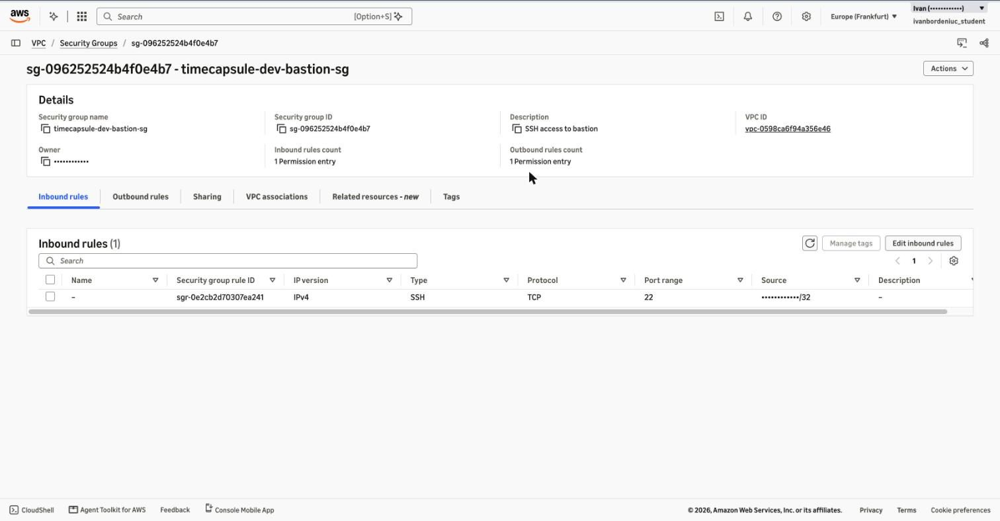

`bastion-sg`: SSH только с моего адреса `/32` (адрес скрыт).

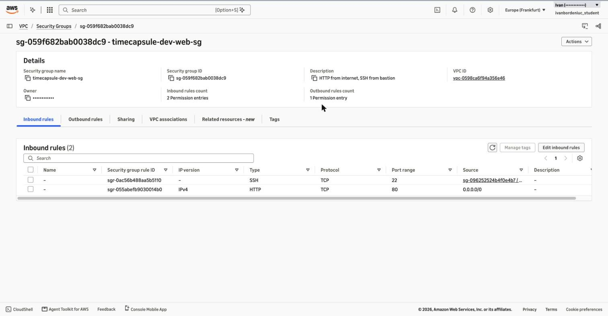

`web-sg`: 80 отовсюду, 22 от `bastion-sg`.

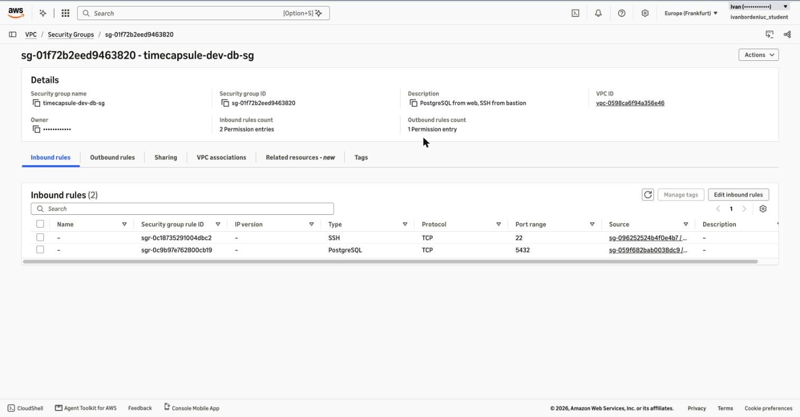

`db-sg`: 5432 от `web-sg`, 22 от `bastion-sg`.

ответ: адрес сервера может поменяться (пересоздали, перенесли), а `10.3.0.0/16` пустил бы к базе вообще всех в VPC, включая `bastion`. Группа `web-sg` это "любой сервер с этой группой", поэтому правило не ломается при смене адреса и не раздаёт доступ лишним.

### Задание 5. Экземпляры и подключение через bastion

Три `t3.micro` на Amazon Linux 2023, ключ `ivanbordeniuc-keypair` из ЛР2, теги на Instances и Volumes: `bastion` (`public-b`, публичный IP), `web` (`public-a`, публичный IP, User data из задания), `db` (`private-a`, без IP). SSH-конфиг:

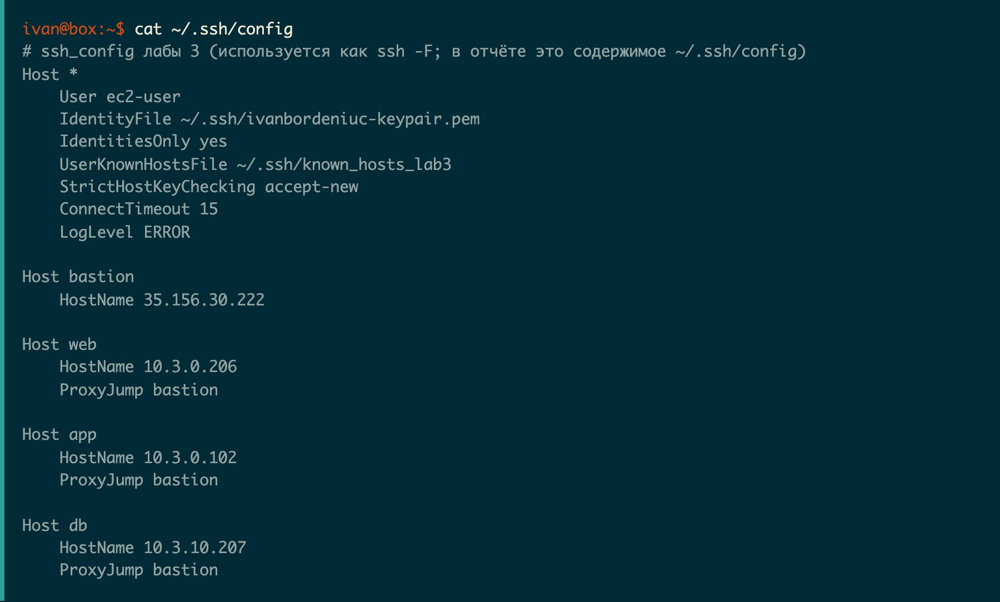

Проверка трёх хостов через `ProxyJump` (приватный ключ остаётся на ноутбуке):

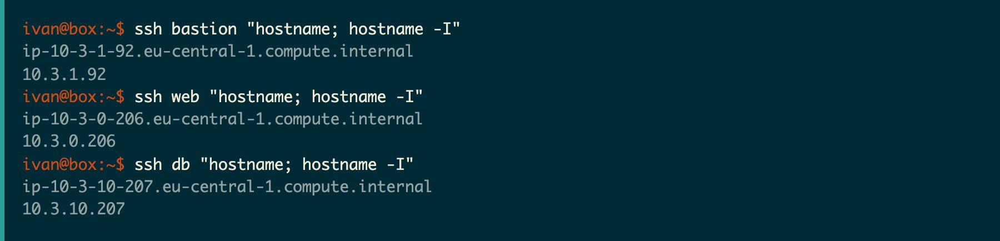

`web` сразу отдаёт страницу с hostname и `10.3.0.206`:

Страница `web` в Chrome по публичному IP: имя хоста и `10.3.0.206`.

`db` не может поставить пакет. Через минуту прервал (`timeout -s INT 60`, это тот же `Ctrl+C`, только ровно через 60 секунд):

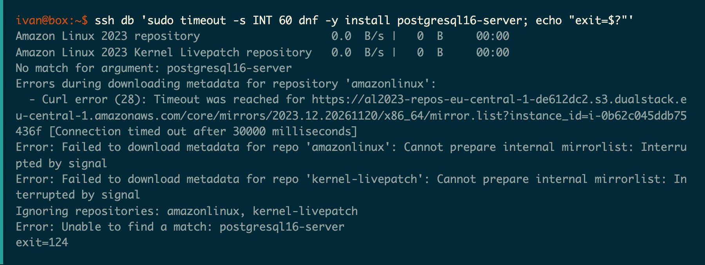

ответ (почему `db` не качает пакеты, что добавить): у `db` нет ни публичного адреса, ни маршрута в интернет, поэтому запрос до зеркала просто не уйдёт, а ответ некуда вернуть. Нужен NAT Gateway в публичной подсети и маршрут `0.0.0.0/0` на него в `private-rt`. `db` при этом остаётся закрытым: NAT пропускает только ответы на исходящие соединения.

### Задание 6. Временный NAT Gateway

Elastic IP `timecapsule-dev-nat-a-eip` с тегами, NAT `timecapsule-dev-nat-a` (Zonal, `public-a`, Public), маршрут `0.0.0.0/0` -> NAT в `private-rt`. На `db`:

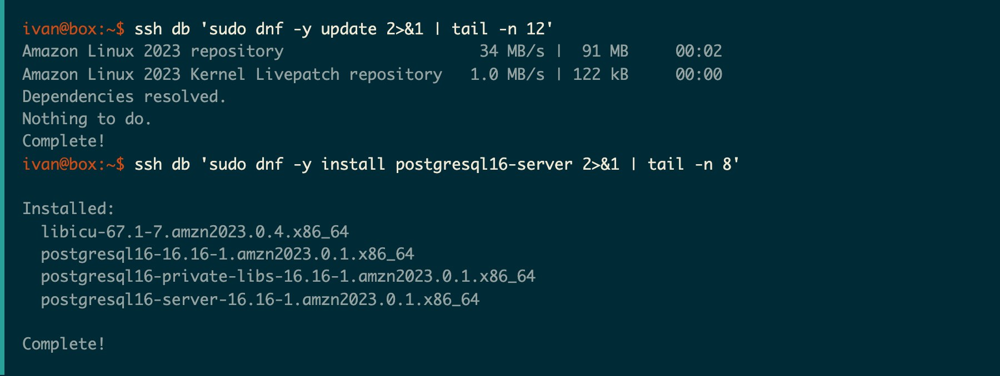

ответ (какой адрес вернул `checkip`): `63.189.12.15`, это Elastic IP NAT-шлюза. `db` в интернет выходит через NAT, а он подменяет приватный адрес `10.3.10.207` на свой публичный. У самого `db` публичного адреса нет.

PostgreSQL: `postgresql-setup --initdb`, `listen_addresses = '*'`, строка в `pg_hba.conf` для `10.3.0.0/24`, `enable --now`, пользователь `student` и база `lab3` (пароль сгенерирован локально, в лог не попал):

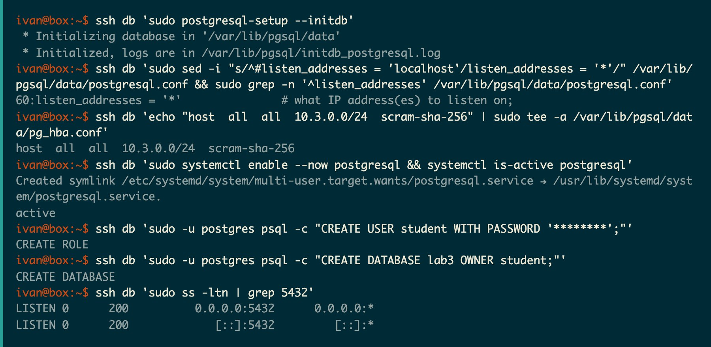

ответ (три механизма защиты): первый, сетевой, нет публичного IP и нет маршрута в IGW: из интернета к `db` просто нельзя дойти. Второй, `db-sg`: даже внутри VPC на 5432 пустит только группу `web-sg`. Третий, `pg_hba.conf`: даже если дошёл до порта, СУБД проверит, какой пользователь, в какую базу и с какой сети. Если ошибиться в одном слое, два других всё ещё держат базу закрытой (например, откроешь 5432 в SG для всех, а маршрута из интернета всё равно нет). Две ошибки подряд уже могут открыть её, поэтому слоёв три.

Удаление: NAT удалён, EIP освобождён (в `Blackhole` маршрут я оставил ради снимка консоли, потом убрал):

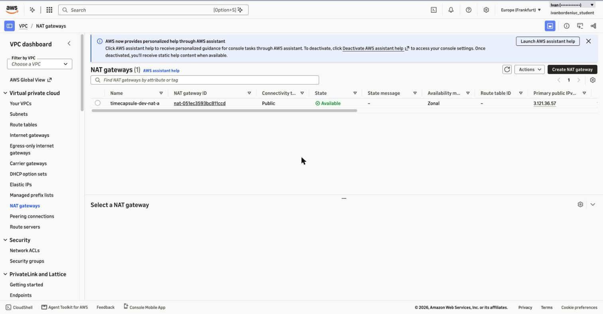

NAT `timecapsule-dev-nat-a` в состоянии `Available`, перед удалением.

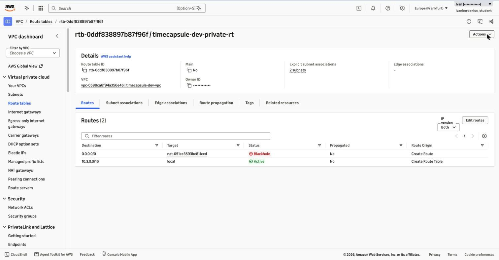

`private-rt` после удаления шлюза: маршрут `0.0.0.0/0` в состоянии `Blackhole`.

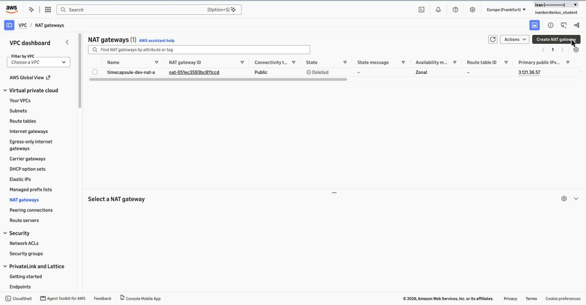

Список `NAT gateways`: строка `Deleted`.

ответ (почему PostgreSQL работает после удаления NAT): NAT нужен только чтобы качать пакеты, сама база живёт на `db` и общается с `web` по локальному маршруту VPC. Для обновлений безопасности придётся снова поднять временный NAT (у меня для этого `nat-up.sh`), поставить обновления и убрать (`nat-down.sh`).

### Задание 7. Проверки

`psql` с `web` на приватный IP `db`:

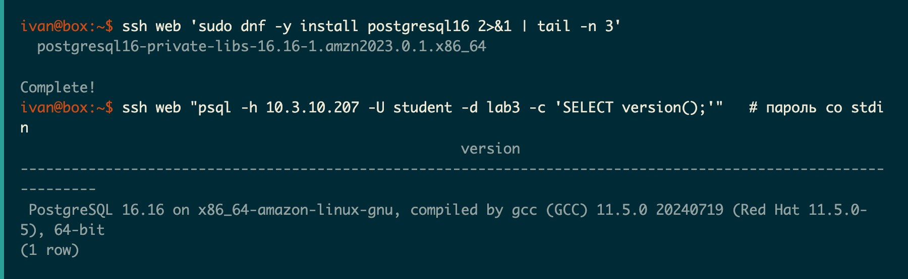

Порт 5432 с `web` и с `bastion`:

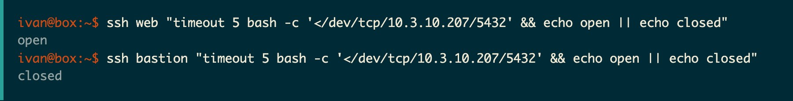

ответ: у `db-sg` одно правило на 5432, и источник в нём `web-sg`. Пакет с `web` под него попадает, пакет с `bastion` нет, и Security Group молча его отбрасывает (поэтому `closed` приходит по таймауту). Маршрут между ними есть, но маршрут решает только "куда", а "можно ли" решает фильтр.

`curl -m 5 https://github.com` с `db`:

ответ: запрос не доходит, потому что у `db` нет ни публичного адреса, ни маршрута наружу, а NAT уже удалён. Из интернета на 5432 попасть нельзя: адреса нет (адрес), маршрута IGW у приватной подсети нет (маршрут), а даже если бы дошёл, `db-sg` пустит только `web-sg`, а `pg_hba` только `10.3.0.0/24` (фильтры).

Network ACL. Правило `90`, `All traffic`, `89.149.x.x/32`, `Deny` в default NACL. С ноутбука `ssh bastion` и сайт перестали открываться, после удаления правила всё вернулось. Второй источник: старый `webserver` из ЛР2 в default VPC, он открыл сайт `web` при включённом правиле.

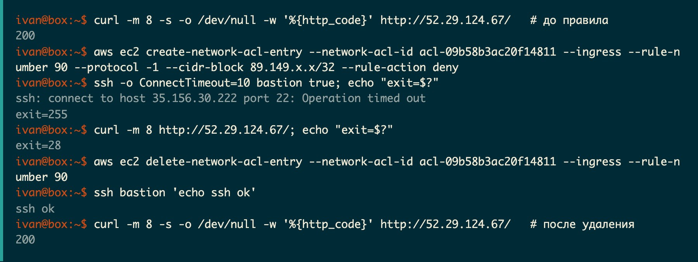

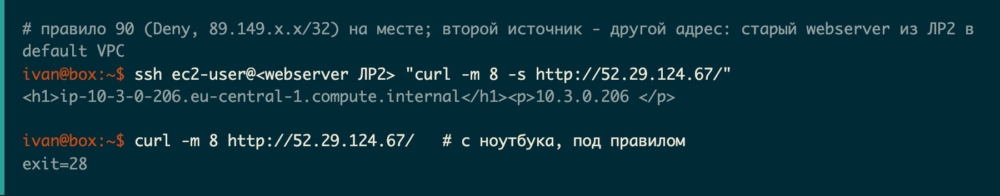

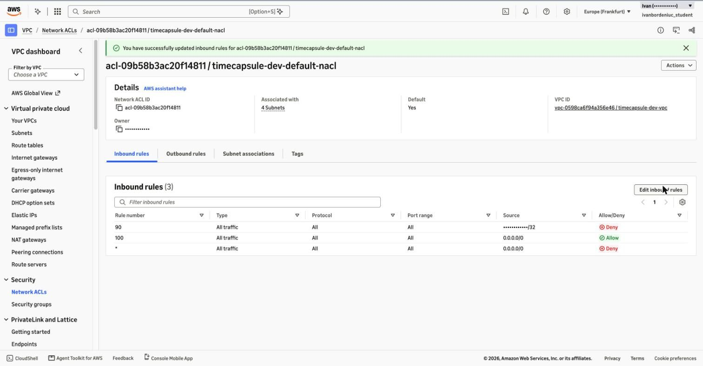

Правило `90` `Deny` для моего адреса `/32` в default NACL (адрес скрыт).

Ошибку браузера (`ERR_CONNECTION_TIMED_OUT` для адреса `web`) вживую проверил в Chrome, но снимок страницы ошибки Chrome инструмент снять не даёт, поэтому доказательством служит терминальный снимок выше (`curl` с ноутбука зависает до таймаута).

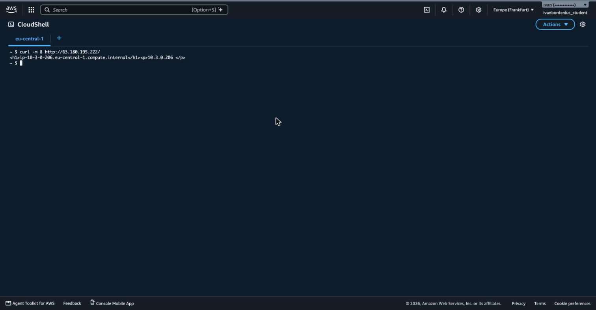

Второй источник: `curl -m 8` из CloudShell открывает страницу `web` при включённом правиле (телефона у меня нет, это честно: вместо него CloudShell и старый `webserver`).

ответ: NACL стоит на границе подсети и смотрит на адрес отправителя до того, как пакет доберётся до Security Group, поэтому `deny` с моего IP режет и SSH (22 на `bastion`), и HTTP (80 на `web`) сразу, хотя ни одна SG не менялась. С другого источника адрес другой, к нему `Deny 90` не подходит и срабатывает обычное `Allow 100`, поэтому сайт открывается. Правила NACL проверяются по возрастанию номера, и первое подошедшее решает; `Allow` по умолчанию имеет номер `100`, и `Deny` должен идти раньше, то есть номер меньше.

Tag Editor: регион `eu-central-1`, `All supported resource types`, `Project=timecapsule`. В список вошли VPC, подсети, IGW, таблицы маршрутов, SG, NACL, экземпляры, диски и ENI. Недостающее (main route table, default NACL, default SG, ENI) дозатегал. CLI-версия того же запроса:

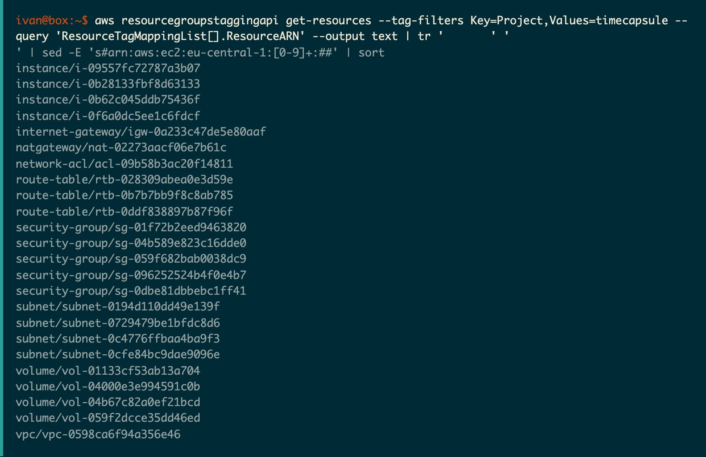

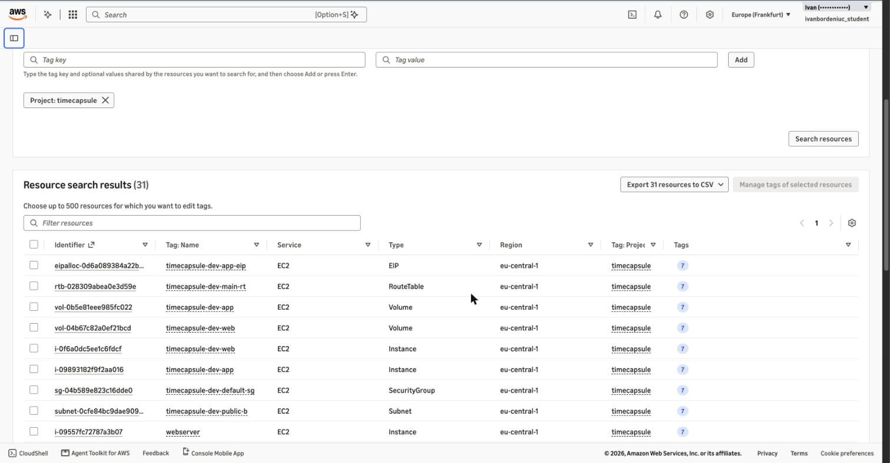

`Tag Editor`, `eu-central-1`, все типы ресурсов, `Project=timecapsule`: 31 ресурс.

ответ: ищу все ресурсы с `Project=timecapsule` (и `Lab=lab3`, если надо только эту работу), получаю полный список и убираю его целиком, ничего не пропустив. `Owner` нужен, чтобы по ресурсу было видно, кого спрашивать и кто отвечает за счёт. Даже в личном аккаунте это спасает от "а это чьё?" и пригодится, когда ресурсов станет много, а аккаунт станет общим.

Остановил `bastion`, `web`, `db` (в конце работы, вместе с остальными).

---

## Часть 2. Продвинутый уровень

### Задание 8. Перенос сервера ЛР2

Запустил `webserver` из ЛР2, приложение отвечало (`/health` `"db":"ok"`, 1 капсула, 2 пользователя, один загруженный файл). Создал образ `timecapsule-dev-app-lab2` (`Tag image and snapshots together`), из него `timecapsule-dev-app` в `public-a` с `web-sg`, без User data. В `~/.ssh/config` добавлен `Host app`.

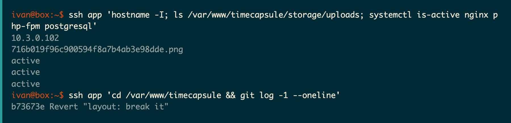

Старый `web` из Части 1 завершён сразу после снимка страницы в Chrome. Старый `webserver` ЛР2 тоже завершён, приложение живёт в `timecapsule-dev-vpc`.

ответ: образ это снимок дисков вместе с описанием, из него поднимается машина один в один. На `app` без всякой установки оказались nginx, PHP-FPM, код в `/var/www/timecapsule`, `.env`, локальный PostgreSQL с данными (пользователи и капсула), загруженный файл и ключи `ec2-user`. База приложения на этот момент всё ещё локальная, на самом `app` (`localhost`).

### Задание 9. Elastic IP

`timecapsule-dev-app-eip` выделен с тегами и привязан к `app`, в `.env` `APP_URL=http://3.122.199.17`, `reload php-fpm`.

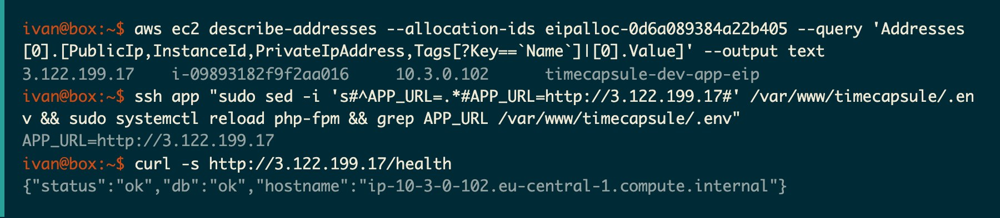

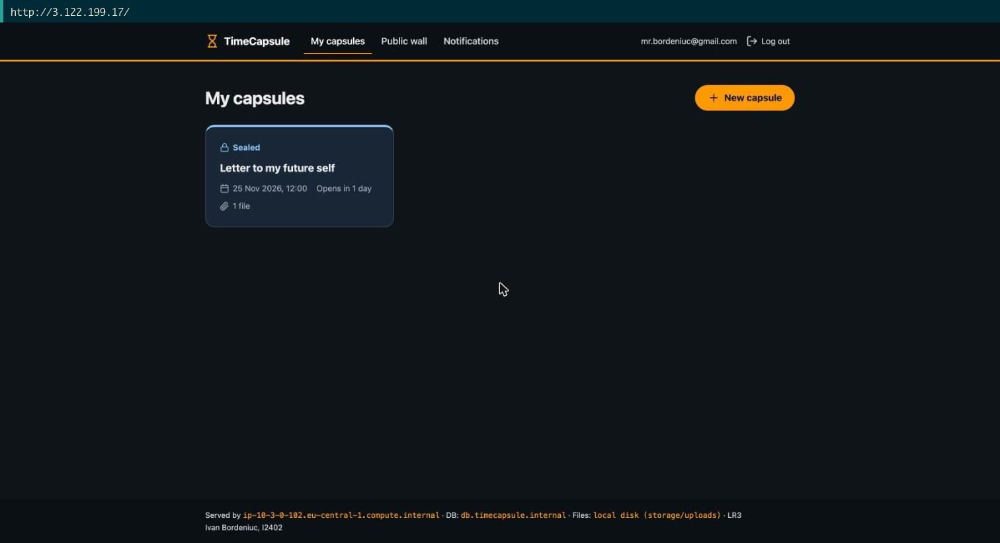

Приложение по Elastic IP после входа; в подвале `DB: db.timecapsule.internal` и `LR3`.

ответ: `app` отдаёт сайт людям, и его адрес должен быть постоянным: иначе после каждой остановки меняются `APP_URL`, закладки и всё, что на него смотрит. `bastion` нужен только мне, адрес я каждый раз читаю из консоли и пишу в конфиг, так что платить за постоянный адрес ему незачем. Остановленный сервер с Elastic IP стоит 0,005 USD в час (около 3,6 USD в месяц), потому что публичный IPv4 в AWS платный, пока он выделен, а не привязан к работающему экземпляру. Когда впереди появится балансировщик, пользователи пойдут на его DNS-имя, и Elastic IP серверу не понадобится.

### Задание 10. База приложения на `db`

Пользователь и база `timecapsule` с новым паролем (сгенерирован локально, в лог и репозиторий не попал), в `pg_hba.conf` вместо `all all` теперь только `timecapsule timecapsule 10.3.0.0/24`, `restart postgresql`:

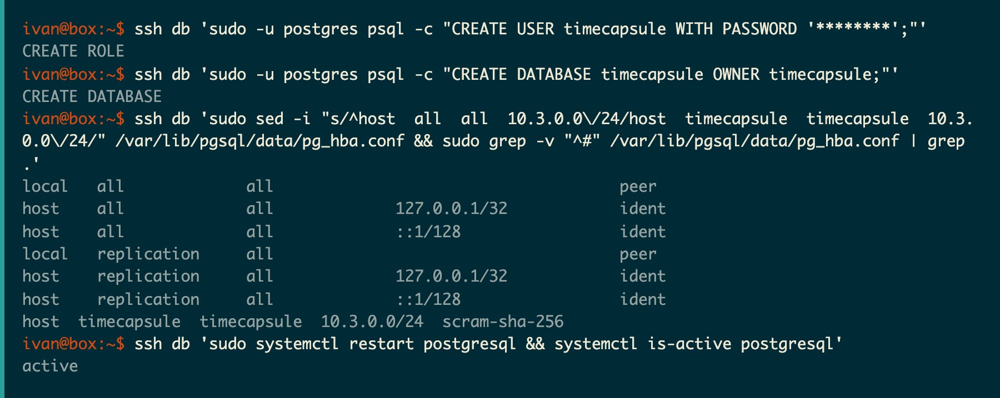

ответ: Security Group это один слой, а пароль другой. Если ошибиться в SG или взломать `app`, до базы всё равно должен остановить пароль. Старый пароль из ЛР2 лежал на сервере, который смотрел в интернет, поэтому ему я больше не верю, а новый ничего не стоит.

### Задание 11. Приватная зона Route 53

Зона `timecapsule.internal` (Private, привязана к `timecapsule-dev-vpc`, с тегами), запись `db` A `10.3.10.207`, TTL 60. Через 1-2 минуты `dig` с `app` отвечает, с ноутбука нет:

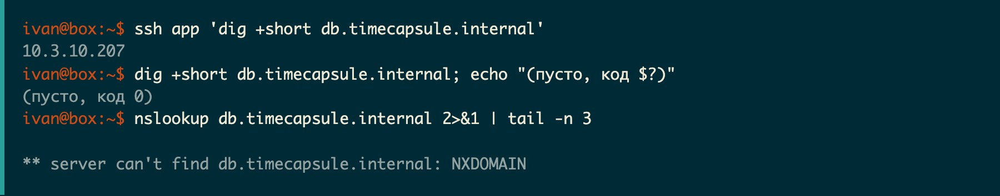

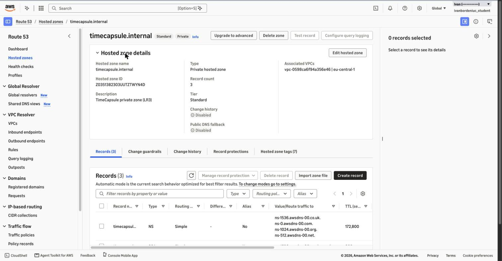

Приватная зона `timecapsule.internal`, привязана к `timecapsule-dev-vpc`.

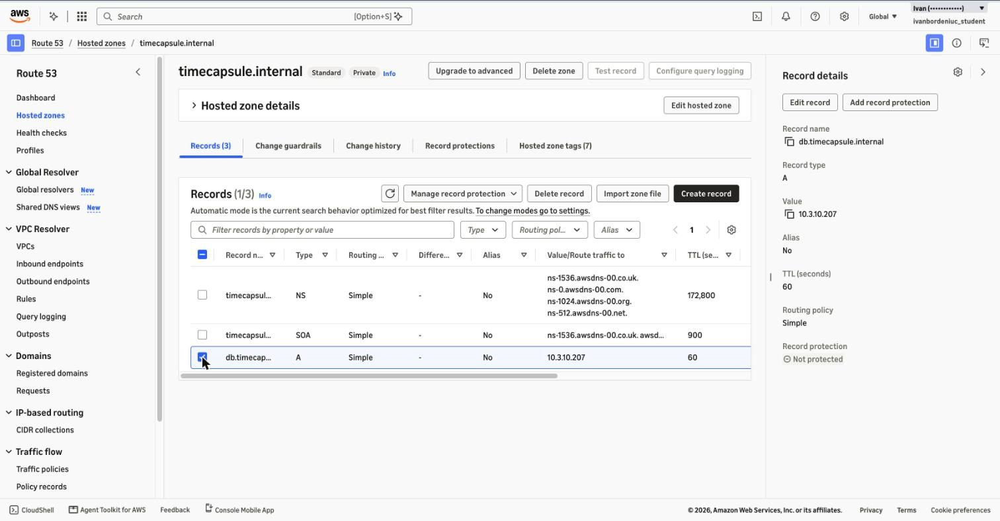

Запись `db.timecapsule.internal`, A, `10.3.10.207`, TTL 60.

ответ: приватная зона привязана только к моей VPC, на неё отвечает DNS-резолвер VPC (адрес `.2`), который видит только мои серверы. Ноутбук спрашивает обычный публичный DNS, там такого имени нет, и приходит `NXDOMAIN`. Если `db` пересоздадут с другим адресом, правлю одну A-запись в зоне, `.env` не трогаю, а клиенты подхватят её через 60 секунд (TTL).

### Задание 12. Перенос данных

`pg_dump` с `app`, затем `psql -f` в `db.timecapsule.internal`:

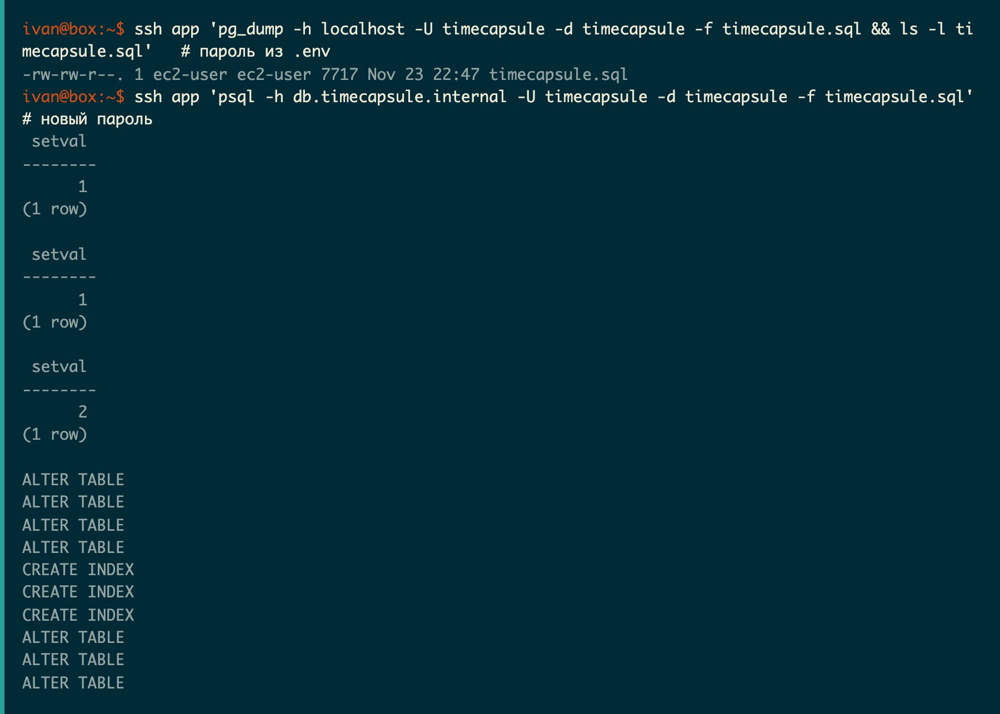

Переключил `.env` (`DB_HOST=db.timecapsule.internal`, новый пароль), `reload php-fpm`, локальный PostgreSQL выключен (`disable --now`), `/health` `"db":"ok"`, в новой базе 2 пользователя и 1 капсула:

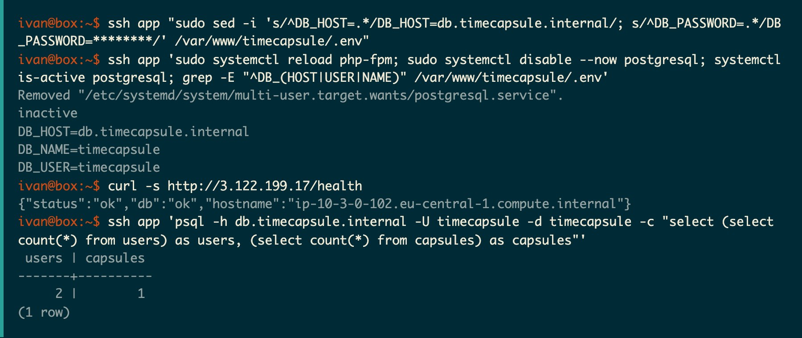

Капсула ЛР2 с вложением на месте после переезда данных в `db`.

Образ и его снимок удалены:

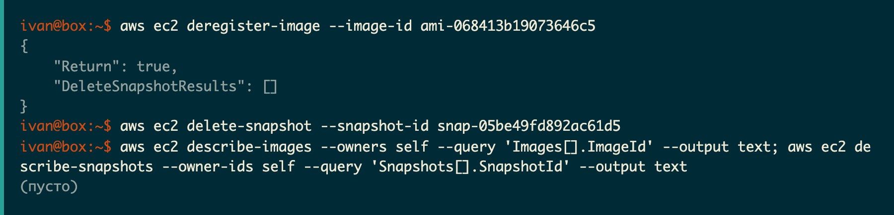

ответ (где файлы): файлы пользователей лежат на диске `app` в `/var/www/timecapsule/storage/uploads`, вместе с образом они переехали на новый диск, а не в базу. Если `app` удалить, диск уйдёт вместе с ним (флаг `DeleteOnTermination`), и вложения пропадут. Поэтому в ЛР4 их надо вынести в S3.

### Задание 13. Деплой и обслуживание

Новая версия: в подвал добавил `LR3` (`footer: add LR3 tag`), push, `ssh app ./deploy.sh` через bastion. Сам `deploy.sh` не менял. Лог сокращён: убраны строки `git pull` про скриншоты ЛР2.

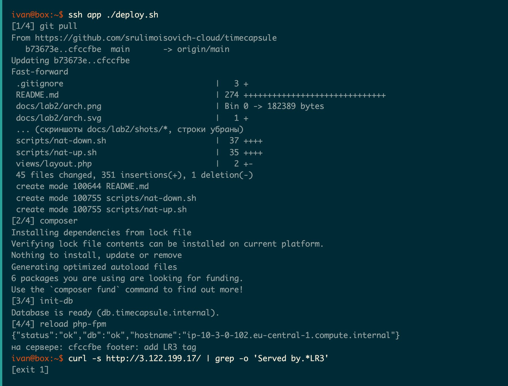

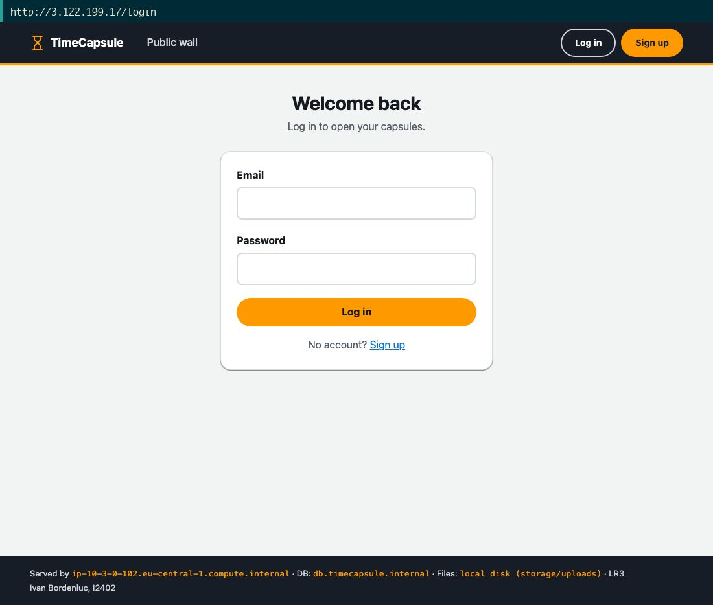

ответ: в `deploy.sh` пути и адресов сети нет, он работает на самом сервере (`cd /var/www/timecapsule`, `git pull`, `composer`, `init-db`, `reload`). Всё, что поменялось, это как я попадаю на сервер, а это живёт в `~/.ssh/config` и в `.env`, которых в скрипте нет.

Отказ базы. Остановил `db`, `/health` ответил за 5 секунд ошибкой (до 30 с не дошло, у приложения таймаут подключения короче), поднял `db`, и приложение само заработало, без правок на `app`:

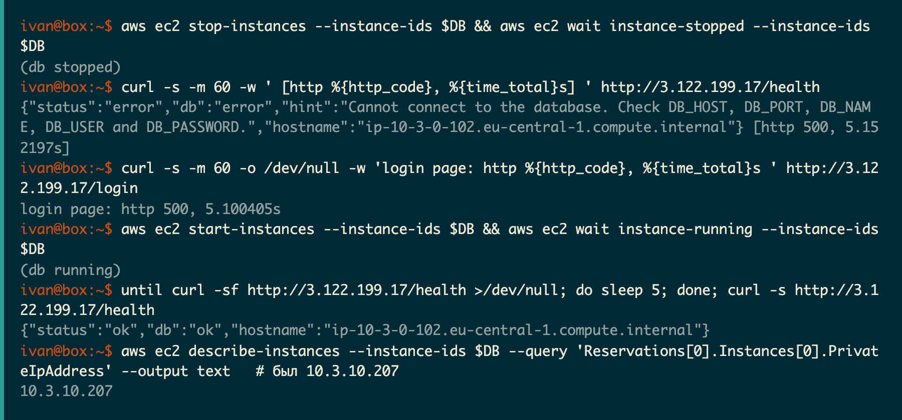

ответ: `/health` вернул HTTP 500 и `"db":"error"` с подсказкой про `DB_HOST` и пароль: PHP жив, а соединения с базой нет. Приватный адрес `db` не менялся (`10.3.10.207`): у остановленного и запущенного экземпляра в VPC он остаётся прежним, меняется только публичный.

Обновление пакетов на `db` скриптами (вариант B). Вывод `nat-up.sh`, `dnf -y update` на `db` и `nat-down.sh`. На свежем Amazon Linux обновлять было нечего (`Nothing to do`), главное, что канал работал (`checkip` вернул EIP NAT):

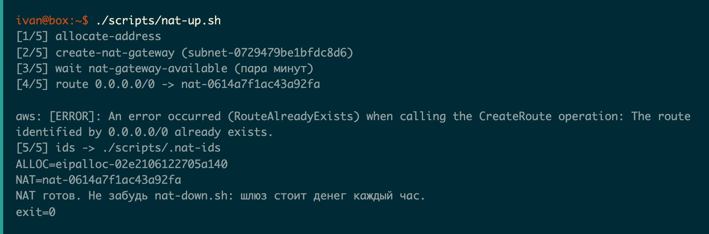

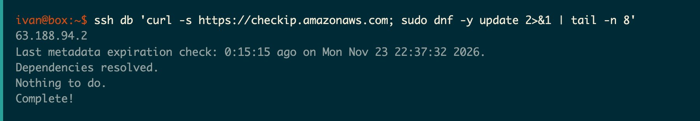

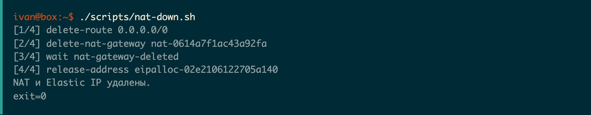

ответ: Elastic IP привязан к NAT-шлюзу, пока шлюз существует, `release-address` отвечает ошибкой, потому что адрес "занят". Поэтому сначала `delete-nat-gateway` и `wait nat-gateway-deleted`, потом освобождение, и то с повторами: шлюз отпускает адрес не мгновенно.

### Задание 14. Архитектура и решение

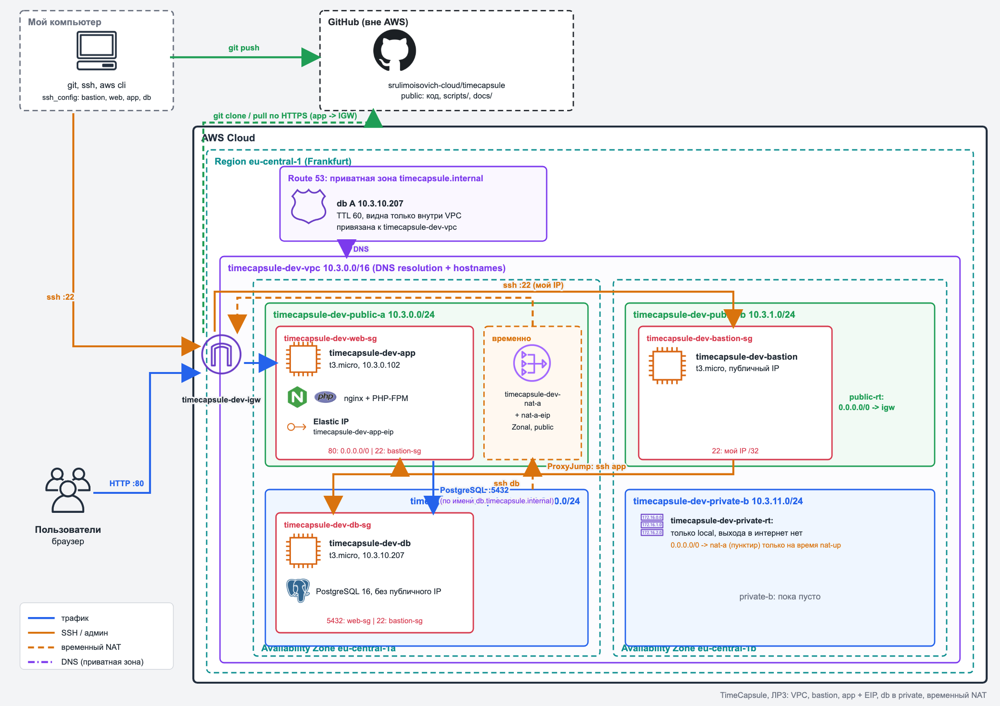

Схема: пользователи, ноутбук и GitHub вне AWS; AWS Cloud, регион, `timecapsule-dev-vpc`, две зоны, четыре подсети, IGW, три сервера со своими SG, приватная зона Route 53, временный NAT пунктиром. Решение про базу: [ADR-0002](../adr/0002-database-placement.md).

---

## Грабли

- Общий `~/.ssh/config` у меня занят чужими `Host bastion`, `web` и `app` из другого аккаунта. `ssh bastion` с ним полез бы не туда. Сделал свой `ssh_config` в папке лабы и обёртку `ssh` с `-F` (`ProxyJump` её тоже подхватывает, проверил через `ssh -v`). Один раз забыл подключить обёртку, команда ушла на чужой адрес и тихо повисла по таймауту.
- Скрипт построения сети сначала молча падал: на macOS `bash` 3.2 с `set -e` и `grep -v` по пустому файлу возвращает 1. Пока разбирался, он успел создать четыре лишних VPC, все четыре удалил, остался один.
- Массив пустых опций (`user data`) в `bash` 3.2 с `set -u` падает на `unbound variable`. Переписал строкой.
- `nat-up.sh` в первый запуск ругнулся `RouteAlreadyExists`: после ручного цикла в `private-rt` остался `Blackhole`. Отработал запасной `replace-route`, ошибку заглушил. Лог `lab3-nat-up` из первого запуска как есть.
- `dnf update` на только что созданном `db` обновлять нечего (`Nothing to do`). В отчёте оставил как есть, скриншот про то, что NAT работает, а не про число пакетов.
- Отказ `db` занял 5 секунд, а не "полминуты" из задания: у приложения короткий таймаут подключения.
- Ручной `Ctrl+C` заменил на `timeout -s INT 60`, чтобы вывод получился повторяемым. Сигнал тот же.

## Итог

На конец работы: `bastion`, `app` и `db` остановлены, `web` и `webserver` ЛР2 завершены, NAT нет, Elastic IP один (`timecapsule-dev-app-eip`, платный всегда, около 0,005 USD в час), приватная зона Route 53 (0,50 USD в месяц). VPC, подсети и Security Group остаются.

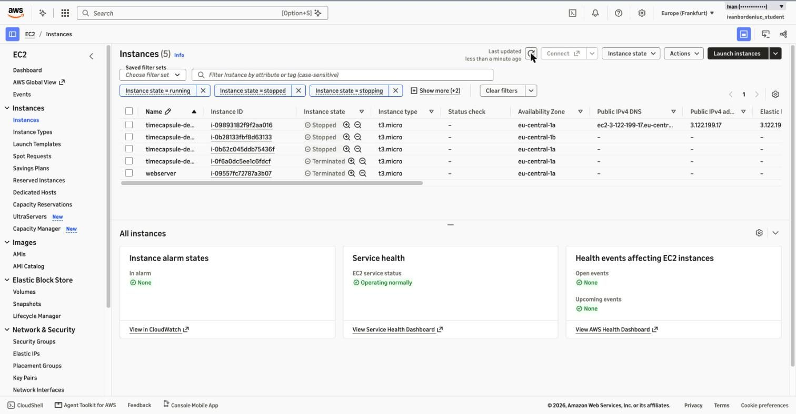

Итог по экземплярам: `bastion`, `app`, `db` остановлены, `web` и `webserver` ЛР2 завершены.

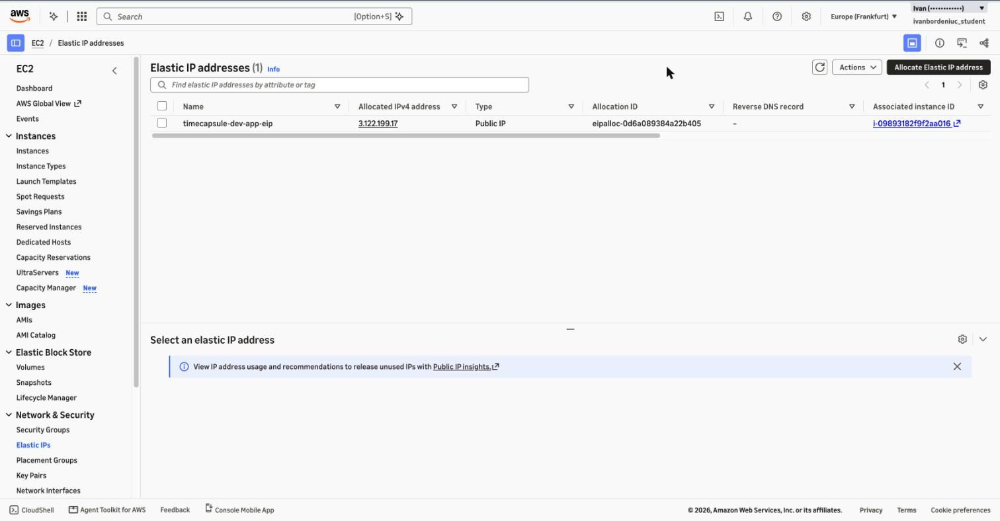

Только адрес `app`.

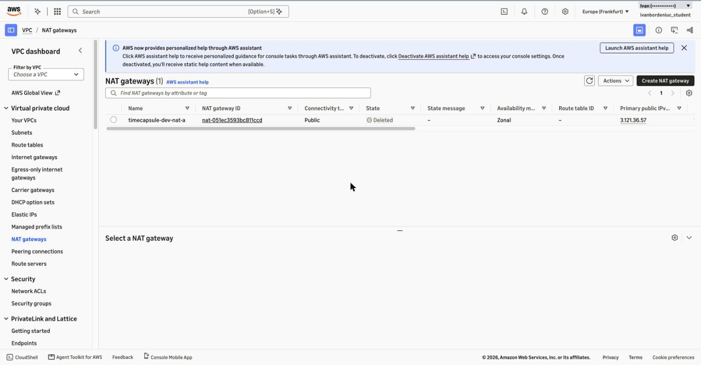

В `NAT gateways` только запись `Deleted`.

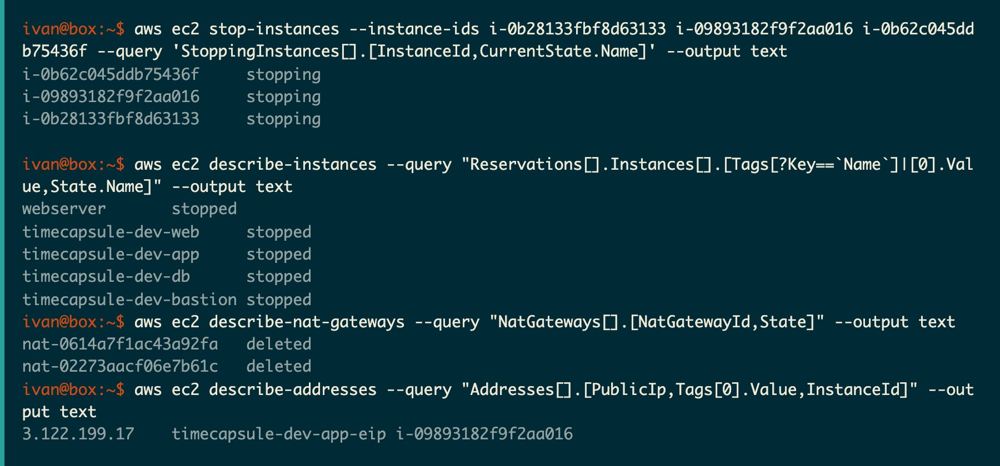

## Q&A (устные вопросы)

1. Как проходит запрос от браузера до базы? Браузер находит публичный адрес `app` (Elastic IP) и приходит на Internet Gateway, он меняет его на приватный `10.3.0.102`. Подсеть `public-a` пропускает по NACL, маршрут `public-rt` (`0.0.0.0/0` -> IGW) возвращает ответ наружу, `web-sg` пускает порт 80 всем, nginx и PHP-FPM запускают приложение. Оно по имени `db.timecapsule.internal` (приватная зона) получает `10.3.10.207`, идёт по маршруту `local` в `private-a`, `db-sg` пускает 5432 только от `web-sg`, а `pg_hba.conf` пускает пользователя `timecapsule` в базу `timecapsule` из `10.3.0.0/24` по паролю.
2. Что нужно злоумышленнику, знающему приватный IP `db`? Одного адреса мало: из интернета до `10.3.10.207` вообще нет маршрута. Нужно сначала оказаться внутри VPC, например взломать `app` (единственный, кого пускает `db-sg`), потом знать пользователя и пароль `timecapsule` и подключаться из `10.3.0.0/24`, иначе `pg_hba` откажет.
3. Чем временный NAT лучше постоянного и какие неудобства? Платишь минуты (около 0,052 USD в час плюс EIP), а не 38 USD в месяц, и пока шлюза нет, из `db` вообще нельзя выйти наружу, поверхность меньше. Неудобство: его надо не забыть создать и удалить (забытый стоит около 1,25 USD в сутки), создание занимает пару минут, а обновления нельзя ставить по расписанию без скрипта.
4. Что будет, если упадёт зона `eu-central-1a`? Сейчас `app`, `db` и NAT в `1a`, поэтому упадёт всё, кроме `bastion` в `1b`. Нужны: второй `app` в `public-b` (или группа автомасштабирования), балансировщик над двумя публичными подсетями, реплика БД в `private-b` (или RDS Multi-AZ) и переключение имени `db`, файлы вне диска сервера (S3) и сессии вне него, второй NAT (если он понадобится) в `1b`.
