# ЛР4. Облачные хранилища. Amazon S3 (TimeCapsule)

- ФИО: Борденюк Иван (Bordeniuc Ivan)
- Группа: I2402
- Специальность: Informatică
- Уровень: продвинутый (Часть 1 + Часть 2, задания 1-14)
- Репозиторий: https://github.com/srulimoisovich-cloud/timecapsule (публичный)
- ADR: [0003. Файлы в S3, а не на диске сервера](../adr/0003-attachment-storage.md)
- Отчёты ЛР2 и ЛР3: [README.md](../../README.md), [docs/lab3](../lab3/README.md)

## Коротко

Сделал бакет `timecapsule-dev-uploads-ivanbordeniuc`: закрытый, с SSE-S3, версионированием, правилом жизненного цикла и политикой "только HTTPS". Руками в консоли и из CLI прошёл Часть 1, потом сочинил политику `timecapsule-dev-app-s3`, проверил её через тестовую роль (десять команд, ожидания записал заранее, все десять совпали) и повесил такую же на роль сервера. Переписал `src/storage.php`: файлы идут в S3, скачивание через 302 на подписанную ссылку на 5 минут. Старое вложение из ЛР2 перенёс `sync`-ом, `storage/uploads` с `app` убрал, `ListBucket` у приложения отобрал: всё работает. Платного нового нет: бакет стоит центы, IAM бесплатный, три сервера работали пару часов и остановлены, как в конце.

Как сняты рисунки. Консоль AWS: настоящие снимки из Chrome (номер аккаунта и домашний IP закрыты). Терминал: настоящий вывод команд, нарисованный из логов. CLI-команды Части 1 и проверки роли гонял с ноутбука (профиль пользователя), команды "на сервере" через `ssh app '...'`. В задании CLI предлагается в CloudShell; результат тот же, снимки CloudShell отмечены ниже. Ключевые значения: версионирование, префикс и теги везде одни, оба правила политик такие же, как в задании.

| Ресурс | Имя | Значение |
| --- | --- | --- |
| Бакет | `timecapsule-dev-uploads-ivanbordeniuc` | `eu-central-1`, ACL выключены, BPA включён, SSE-S3 |
| Правило жизненного цикла | `timecapsule-dev-noncurrent` | `uploads/`, IA 30 дн., удаление 90 дн. (оставить 2), multipart 7 дн. |
| Политика IAM | `timecapsule-dev-app-s3` | v1: `list` + `rw`, v2 (по умолчанию): только `rw` |
| Тестовая роль | `timecapsule-dev-s3-tester` | trust: этот аккаунт |
| Роль сервера | `timecapsule-dev-app-role` | trust: `ec2.amazonaws.com`, instance profile того же имени, у `app` |
| Сервер | `timecapsule-dev-app` | `i-09893182f9f2aa016`, `3.122.199.17` |

Теги на всём: `Name`, `Project=timecapsule`, `Environment=dev`, `Owner=ivanbordeniuc`, `Lab=lab4`, плюс `Team=solo` и `Stack=php`.

---

## Часть 1. Базовый уровень

### Задание 1. Бакет и объекты

Бакет создал командами (General purpose, `BucketOwnerEnforced` = ACLs disabled, все четыре галки Block Public Access, шифрование SSE-S3, теги). Версионирование на этом шаге выключено: `get-bucket-versioning` пустой. Папки `uploads/` и `backups/`, в `uploads/` картинка `cat.webp` (1280x720, WebP) и `report.pdf`, в `backups/` `bk.txt`.

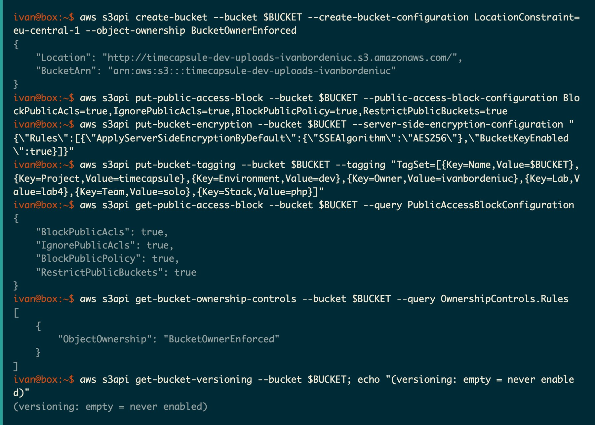

Создание бакета и проверка настроек из CLI.

TODO(shot: lab4-bucket-folders)

Бакет с папками `uploads` и `backups`.

TODO(shot: lab4-object-props)

Свойства `cat.webp`: ключ, тип, `ETag`, `Object URL`.

TODO(shot: lab4-object-url)

`Object URL` в браузере: `AccessDenied`.

ответ: ключ картинки `uploads/cat.webp`: "папка" в S3 это просто часть имени. `Object URL` не открывается, потому что бакет закрыт Block Public Access, а у браузера нет подписи, и то, что я владелец, ничего не меняет: владелец это про права в IAM, а браузер приходит анонимно. `Create folder` ничего не создаёт кроме пустого объекта размером 0 с ключом `uploads/` (в `aws s3 ls --recursive` он виден как `uploads/` с размером 0).

### Задание 2. CLI

`photo.txt` в `uploads/`, папка `2026` через `sync`, три `ls`, `head-object`, скачивание и удаление `report-2.txt`.

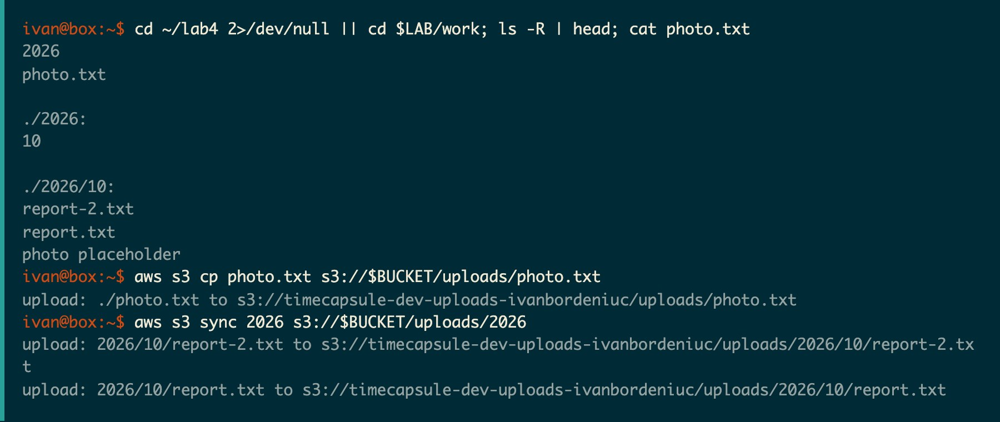

Загрузка `photo.txt` и `sync` папки `2026`.

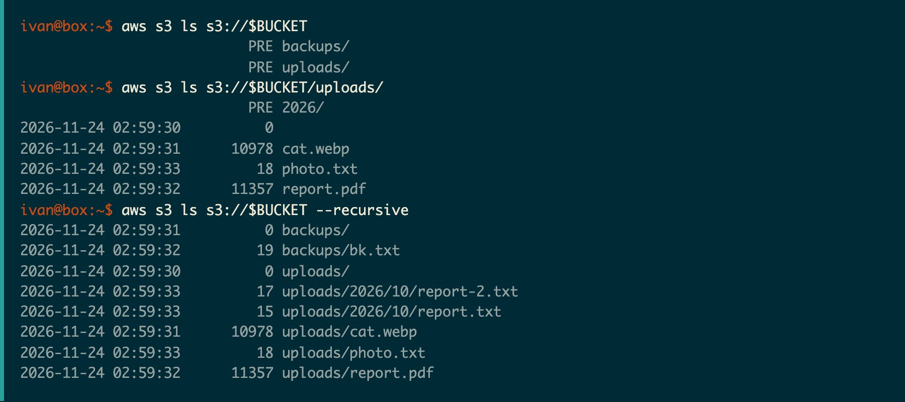

Три варианта `aws s3 ls`.

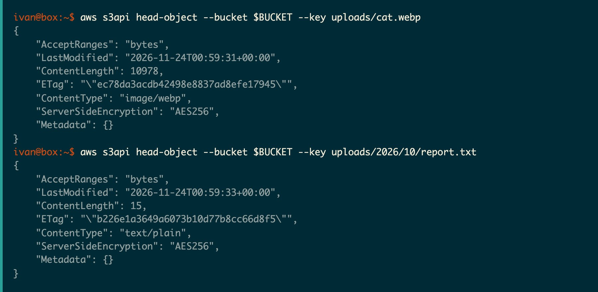

`head-object` картинки и `report.txt`.

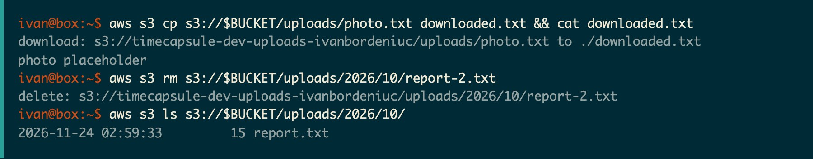

`cp` в `downloaded.txt` и `rm` `report-2.txt`.

ответ: `ls` без `--recursive` листит "по папкам": ключи с общим префиксом до `/` S3 сворачивает в `PRE`, а `--recursive` отдаёт все ключи плоским списком. У `report.txt` `Content-Type` `text/plain`: CLI угадал по расширению `.txt`, хотя я его не указывал.

### Задание 3. Политика бакета: только HTTPS

`Deny`, `Principal "*"`, `s3:*`, два ARN (бакет и `/*`), условие `Bool aws:SecureTransport = false`.

TODO(shot: lab4-bucket-policy)

Политика бакета в консоли.

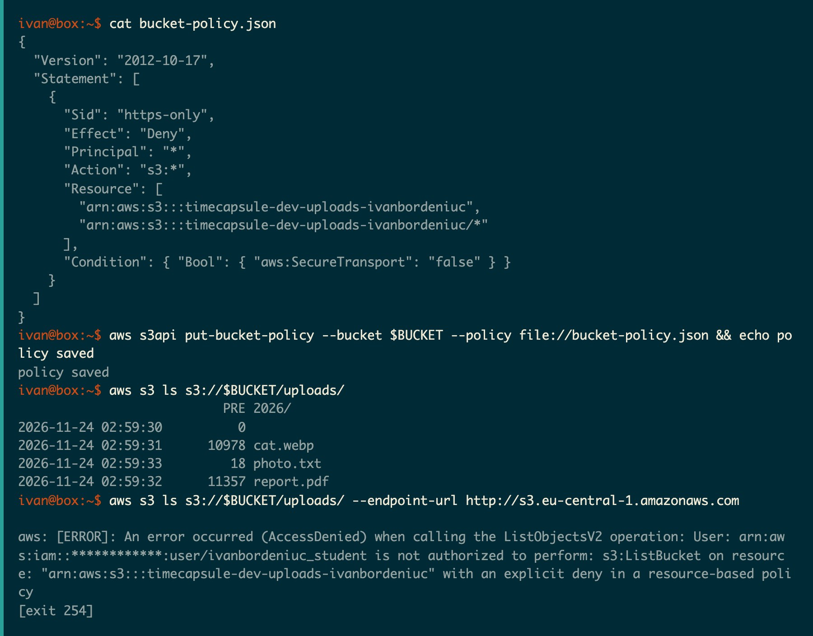

Политика, `ls` по HTTPS работает, по `http://` даёт `AccessDenied` с явным запретом.

ответ: у меня права администратора, но явный `Deny` бьёт любой `Allow`, поэтому запрос по `http://` режется независимо от того, кто спрашивает. Block Public Access не помешал, потому что он блокирует политики, которые ОТКРЫВАЮТ доступ всем; наша политика наоборот запрещает и ничего не открывает.

### Задание 4. Версионирование

Включил версионирование (после загрузки первых файлов: у них `Version ID = null`), загрузил `notes.txt` v1, затем v2, дальше по заданию в консоли.

TODO(shot: lab4-versions-null)

`Show versions`: у старых файлов `null`, у `notes.txt` две версии.

TODO(shot: lab4-delete-marker)

После `delete` при `Show versions`: маркер удаления и две версии.

TODO(shot: lab4-restored)

Маркер удалён, `notes.txt` вернулся с `v2`.

TODO(shot: lab4-rollback-v1)

Версия `v2` удалена, текущая `v1`.

ответ: удаление в шаге 3 без `Show versions` только кладёт маркер удаления сверху: данные целы, а снять маркер можно (шаг 4). Удаление в шаге 5 идёт по конкретному `Version ID` и окончательное: консоль даже просит набрать подтверждение `permanently delete`, вернуть версию нельзя. Первое защищает от случайного удаления, а второе приложению нужно запретить (у моей политики `DeleteObjectVersion` нет).

### Задание 5. Жизненный цикл

TODO(shot: lab4-lifecycle-review)

`Review transition and expiration actions`.

TODO(shot: lab4-lifecycle-rule)

Созданное правило `timecapsule-dev-noncurrent`.

ответ: файл, перезаписанный 10 раз за неделю, имеет 1 текущую и 9 неактуальных версий. Каждая неактуальная версия уйдёт в Standard-IA через 30 дней после того, как перестала быть текущей, а удаляться начнут через 90 дней, но две самые новые неактуальные останутся при любом возрасте. Маленькие тестовые файлы в IA не попадут: у S3 минимальный размер объекта для такого перехода 128 КБ. Незавершённая загрузка частями это начатая `multipart upload`, из которой не собрали объект: загруженные части лежат в бакете, в `ls` их не видно, а место они занимают и оплачиваются, пока их не удалить.

### Задание 6. Подписанные ссылки

TODO(shot: lab4-presign-console-form)

Ссылка из консоли на 5 минут для `cat.webp`.

TODO(shot: lab4-presign-console-open)

Открыта в приватном окне (подпись закрыта).

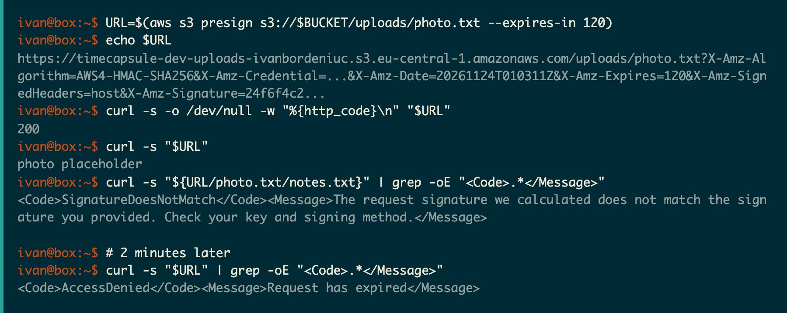

Ссылка CLI на 120 с: открылась; подмена ключа и просроченная.

ответ: подмена ключа даёт `SignatureDoesNotMatch` (403), просроченная ссылка даёт `AccessDenied: Request has expired` (403). Другой файл по такой ссылке не достать, потому что имя объекта входит в подписываемую строку, а подпись считается секретным ключом: поменяешь ключ, подпись перестаёт подходить. `aws s3 presign` в S3 вообще не ходит: он считает подпись локально, ему нужны только ключ и часы.

Убрал временное: `rm -rf ~/lab4` (рабочая папка на ноутбуке). Бакет остался.

---

## Часть 2. Продвинутый уровень

### Задания 7-8. Политика приложения и тестовая роль

Политика `timecapsule-dev-app-s3`, v1: два правила, `list` и `rw`, без `*` в `Action` и `Resource`:

```json
{
  "Version": "2012-10-17",
  "Statement": [
    {
      "Sid": "list",
      "Effect": "Allow",
      "Action": "s3:ListBucket",
      "Resource": "arn:aws:s3:::timecapsule-dev-uploads-ivanbordeniuc",
      "Condition": { "StringLike": { "s3:prefix": ["uploads/*"] } }
    },
    {
      "Sid": "rw",
      "Effect": "Allow",
      "Action": ["s3:GetObject", "s3:PutObject", "s3:DeleteObject"],
      "Resource": "arn:aws:s3:::timecapsule-dev-uploads-ivanbordeniuc/uploads/*"
    }
  ]
}
```

TODO(shot: lab4-policy-v1)

Документ политики v1 в консоли и теги (`lab4-policy-tags`).

TODO(shot: lab4-tester-trust)

Роль `timecapsule-dev-s3-tester`: доверие (аккаунт) и права (только `-app-s3`).

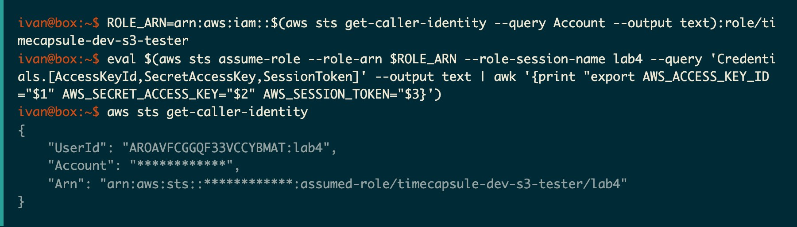

`get-caller-identity` от имени роли: `assumed-role/timecapsule-dev-s3-tester/lab4`.

Таблицу "Ожидаю" я записал до запуска (файл `lab04/files/expect.txt` с меткой времени, лежит у меня рядом с логом). Результат совпал по всем десяти строкам.

| № | Команда | Ожидаю | Получил | Какое правило сработало |
| --- | --- | --- | --- | --- |
| 1 | `aws s3 cp test.txt s3://$BUCKET/uploads/test.txt` | разрешено | разрешено | разрешение в политике (`rw`, `PutObject`) |
| 2 | `aws s3 ls s3://$BUCKET/uploads/` | разрешено | разрешено | разрешение в политике (`list`, `prefix=uploads/`) |
| 3 | `aws s3 ls s3://$BUCKET` | AccessDenied | AccessDenied | неявный запрет (пустой `prefix`, условие не выполнено) |
| 4 | `aws s3 cp s3://$BUCKET/uploads/photo.txt -` | разрешено | разрешено | разрешение в политике (`rw`, `GetObject`) |
| 5 | `aws s3 ls s3://$BUCKET/backups/` | AccessDenied | AccessDenied | неявный запрет (`prefix=backups/`) |
| 6 | `aws s3 cp test.txt s3://$BUCKET/backups/test.txt` | AccessDenied | AccessDenied | неявный запрет (`PutObject` только на `uploads/*`) |
| 7 | `aws s3api list-object-versions --bucket $BUCKET --prefix uploads/` | AccessDenied | AccessDenied | неявный запрет (нужен `s3:ListBucketVersions`, его нет) |
| 8 | `aws s3api delete-object ... --version-id <VersionId>` | AccessDenied | AccessDenied | неявный запрет (нужен `s3:DeleteObjectVersion`, его нет) |
| 9 | `aws s3 rm s3://$BUCKET/uploads/test.txt` | разрешено | разрешено | разрешение в политике (`rw`, `DeleteObject`): лёг маркер удаления |
| 10 | `aws s3 ls s3://$BUCKET/uploads/ --endpoint-url http://...` | AccessDenied | AccessDenied | явный запрет в политике бакета (`aws:SecureTransport=false`) |

Несовпадений нет. Для команды 8 `VersionId` я взял админским пользователем (из `list-object-versions`) после команды 1.

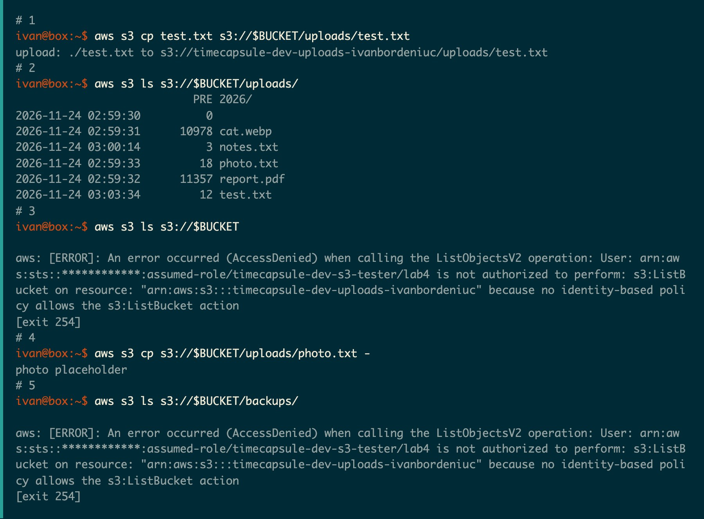

Команды 1-5 от имени роли.

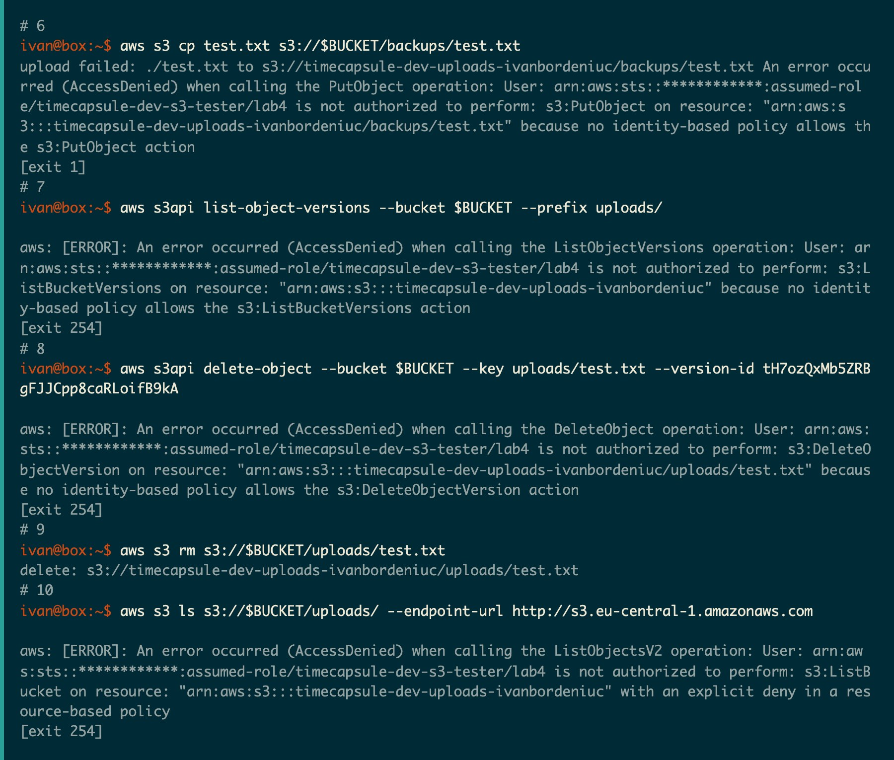

Команды 6-10 от имени роли.

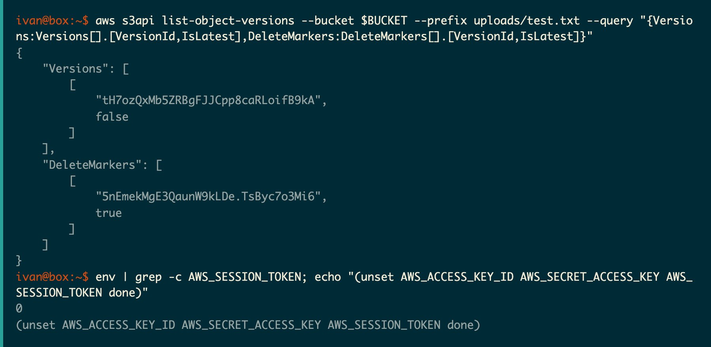

`test.txt` после команды 9: версия цела, сверху маркер. Переменные роли сброшены `unset`.

ответ: политика доверия отвечает, КТО может взять роль (`sts:AssumeRole`), политика прав отвечает, ЧТО роль может делать в AWS. После команды 9 `test.txt` не стёрт: сверху лежит маркер удаления, версия `tH7oz...` осталась, и если маркер убрать, файл вернётся. Злоумышленник с учётными данными приложения безвозвратно файлы не уничтожит: `DeleteObjectVersion` у роли нет, и всё, что он может, это класть маркеры и новые версии. С `"s3:*"` он мог бы удалять конкретные версии окончательно, выключить версионирование и поменять политику бакета.

### Задание 9. Роль сервера

Роль `timecapsule-dev-app-role` (trust `ec2.amazonaws.com`, та же политика, теги) привязал к `app` без перезапуска (instance profile тем же именем).

TODO(shot: lab4-app-role-attached)

`Security` у `app`: роль привязана.

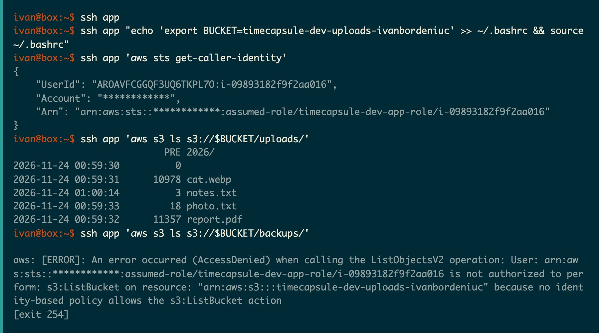

`get-caller-identity`, `ls uploads/` (ok), `ls backups/` (AccessDenied) на `app`.

ответ: учётные данные CLI на сервере взял сам из метаданных экземпляра (IMDS): EC2 выдаёт временные ключи роли из instance profile. Политика доверия этой роли разрешает `sts:AssumeRole` сервису `ec2.amazonaws.com`, а у тестовой роли принципал это мой аккаунт. Такие ключи безопаснее файла `.env`: они короткоживущие, сами обновляются, не лежат на диске и не попадут в публичный репозиторий.

### Задание 10. Перенос файлов

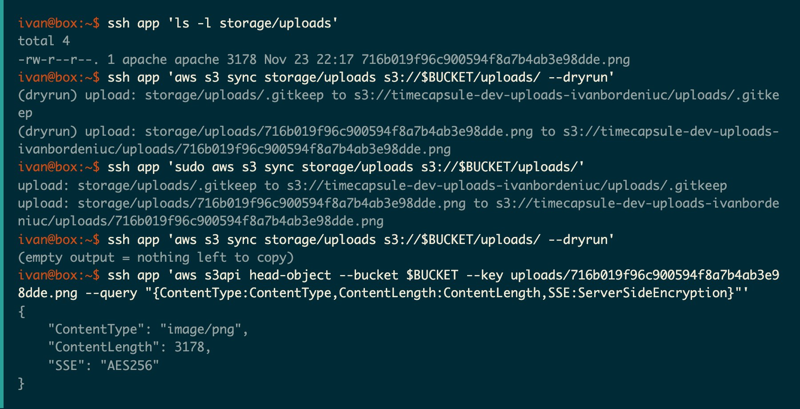

`sync --dryrun`, `sync` под `sudo`, повторный `--dryrun` пустой, `Content-Type` у `.png`: `image/png`.

ответ: прав хватило, отдельных не понадобилось. `sync` использует `ListBucket` (смотрит, что уже есть, по префиксу `uploads/`, это условие проходит) и `PutObject`. В бакет заодно уехал `storage/uploads/.gitkeep` (он лежит в репозитории); потом удалил его `aws s3 rm`.

### Задание 11. Модуль хранения

`composer require aws/aws-sdk-php` (на `app` во временной копии, `composer.json` и `composer.lock` закоммичены), `S3_BUCKET` и `AWS_REGION` в `.env.example` и `.env` на сервере, ключей нет. `src/storage.php` переписан: `s3()` с `static`, `storage_save()` (`putObject`, `SourceFile`, `mime_content_type`), `storage_delete()`, `storage_url()` и `storage_stream()` (302 на ссылку 5 минут, `ResponseContentType`, `ResponseContentDisposition`). Права на капсулу проверяются в контроллере до вызова. Подвал: `S3: timecapsule-dev-uploads-ivanbordeniuc`.

TODO(shot: lab4-storage-diff)

Изменения модуля хранения: https://github.com/srulimoisovich-cloud/timecapsule/commit/9967b50 (разбивка на `storage_url`: `a4bd3d6`).

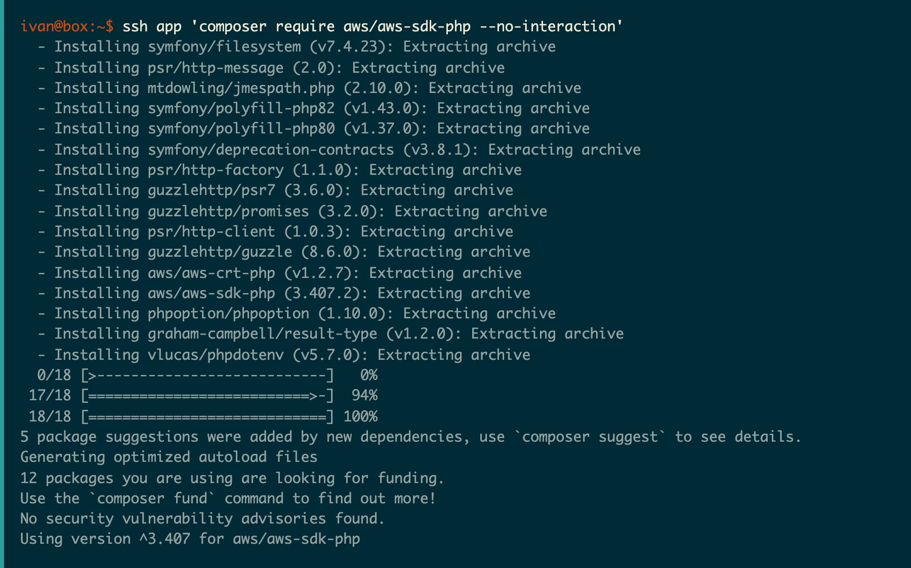

`composer require` на `app` (во временной копии).

### Задание 12. Деплой и проверка

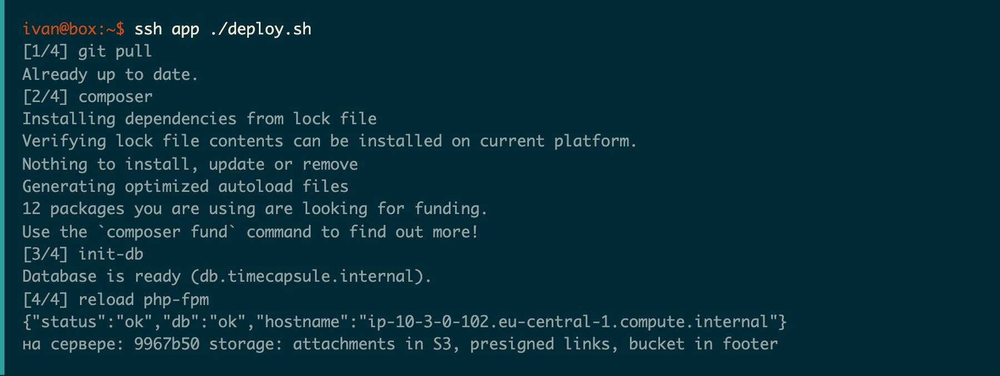

`./deploy.sh`: `git pull`, `composer install`, `init-db`, `reload php-fpm`, `/health` ok.

TODO(shot: lab4-new-objects)

Новые объекты под `uploads/` (картинка и PDF от приложения), `Content-Type` (`lab4-new-pdf-content-type`).

TODO(shot: lab4-presigned-url)

Адресная строка картинки: `...s3.eu-central-1.amazonaws.com/uploads/...?X-Amz-...` (подпись обрезана).

TODO(shot: lab4-capsule-pdf)

PDF скачан под исходным именем.

TODO(shot: lab4-link-expired)

Та же ссылка через 5 минут: `Request has expired`.

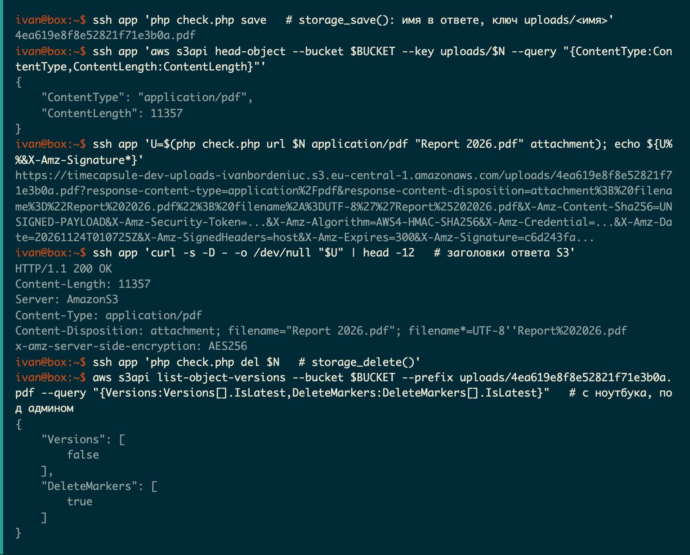

Модуль на `app` через роль: `storage_save`, подписанная ссылка (заголовки: `application/pdf`, `attachment; filename="Report 2026.pdf"`), `storage_delete`: объект под маркером.

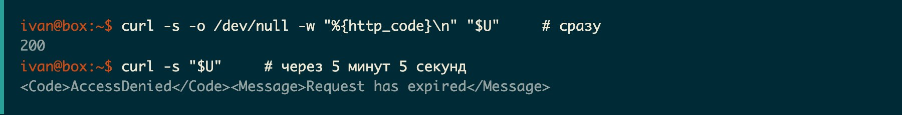

Ссылка из модуля: сразу 200, через 5 минут 5 секунд `Request has expired`.

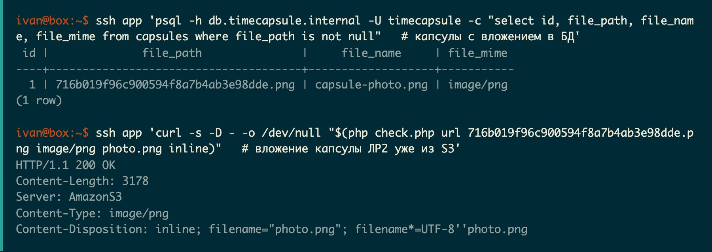

Вложение капсулы из ЛР2 (id 1) уходит по подписанной ссылке на S3.

TODO(shot: lab4-deleted-marker)

После удаления капсулы с вложением: объект с маркером (`Show versions`).

ответ: пересланную ссылку не нужно отзывать, потому что она живёт 5 минут сама и привязана к одному объекту; отозвать подписанную ссылку по-другому и нельзя, остаётся только ждать срока. После удаления капсулы в бакете остаются сама версия файла и маркер удаления. По правилу `timecapsule-dev-noncurrent` у одного файла версия не пропадёт: она одна из двух самых новых неактуальных, а правило оставляет их навсегда. Чтобы стереть её окончательно, надо удалить версию по `Version ID` вручную либо добавить правило с `Number of newer versions to retain` 0.

### Задание 13. Сервер без состояния

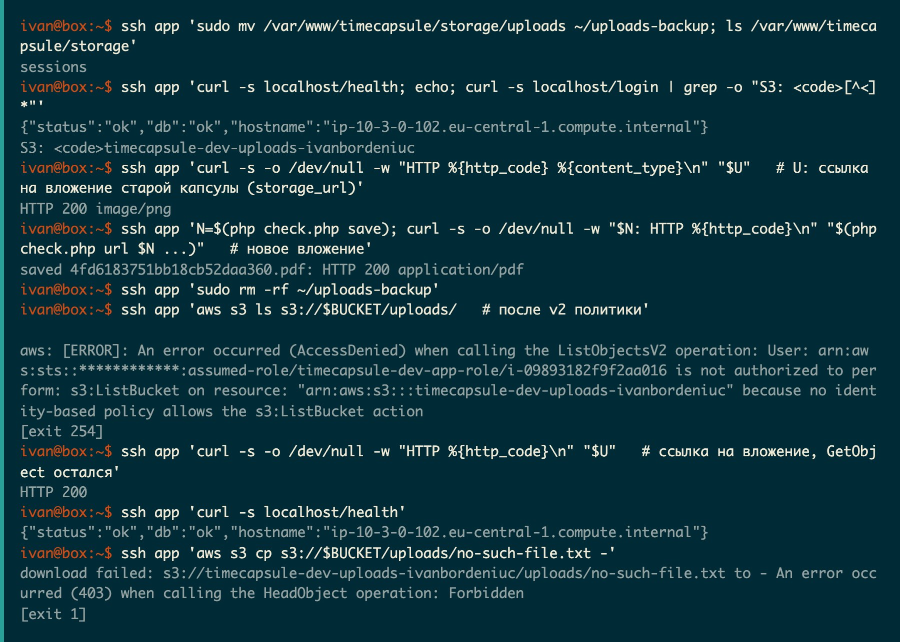

`storage/uploads` перенесён и удалён, приложение (`/health`, подвал, ссылки на старое и новое вложение) работает; после политики v2 (без `ListBucket`) `ls uploads/` на сервере даёт `AccessDenied`, ссылки на вложения по-прежнему работают.

TODO(shot: lab4-policy-versions)

`Policy versions`: v2 по умолчанию, v1.

TODO(shot: lab4-stateless-app)

Приложение с вложениями после удаления `storage/uploads` и новая капсула с вложением.

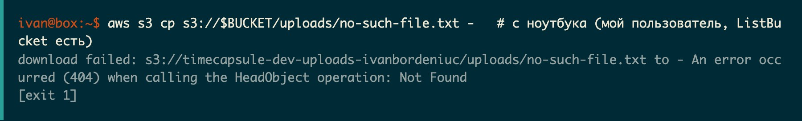

Ноутбук: ответ `404 Not Found`.

TODO(shot: lab4-cloudshell-404)

(необязательно) то же в CloudShell.

ответ: у меня (ноутбук, администратор, `ListBucket` есть) S3 честно говорит 404, а серверу, у которого права `ListBucket` нет, отвечает 403: без права листинга он не выдаёт, есть такой ключ или нет, чтобы нельзя было перебирать имена. Чтобы заменить `app` новым сервером, достаточно запустить новый экземпляр из образа с тем же instance profile, положить `.env` (БД и `S3_BUCKET`) и выкатить код: файлов на сервере нет.

### Задание 14. Архитектура и решение

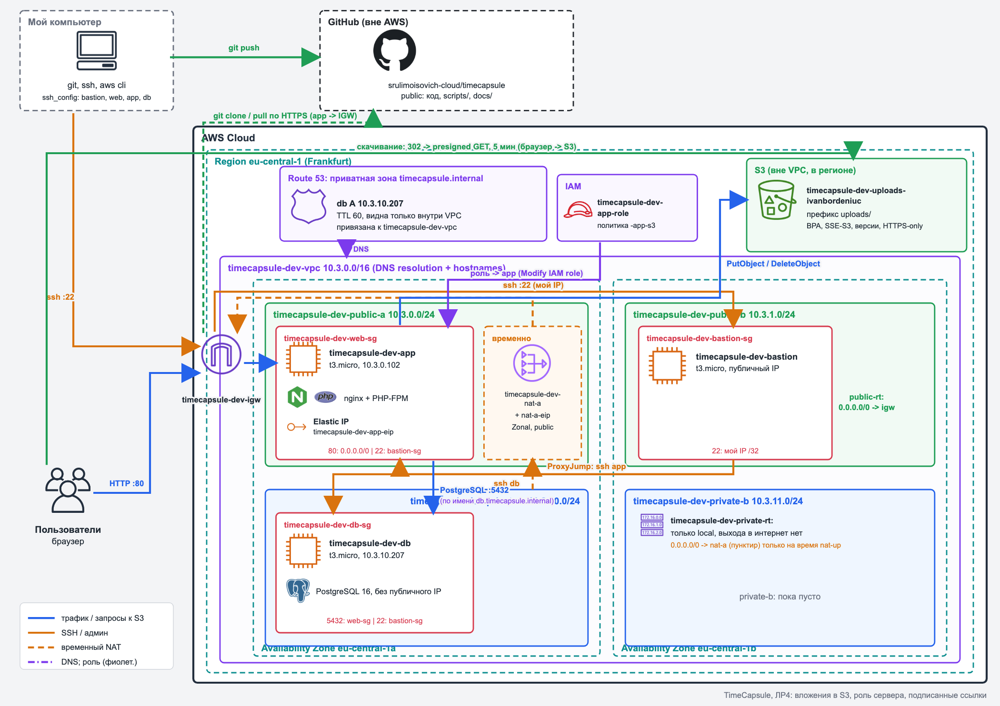

Схема ЛР3 плюс бакет вне VPC в регионе, роль у `app`, две стрелки: `PutObject`/`DeleteObject` и скачивание браузером по подписанной ссылке.

Решение записано в [ADR-0003](../adr/0003-attachment-storage.md): EBS, EFS и S3, выбран S3.

---

## Грабли

- Бакет и версионирование я сделал из CLI, а в мастере консоли хотелось показать пошагово. Отметил это в начале и снял свойства уже готового бакета.
- Правил `.env` на сервере через `sed -i`: файл пересоздался с группой `ec2-user`, php-fpm (apache) его читать перестал и приложение ушло в 500 с `localhost` вместо `db.timecapsule.internal`. Лечится `sudo chgrp apache .env`.
- В `sync` уехал `.gitkeep`: лежит в `storage/uploads` под git. Нашёл по `ls`, удалил.
- Под `zsh` `$ACC:root` внутри строки превращается в модификатор: ARN в trust получился `...<аккаунт>oot`. Исправил фигурными скобками.
- Правило с `Number of newer versions to retain = 2` не удаляет единственную старую версию удалённой капсулы никогда. Заметил, когда решал вопрос 12.

## Q&A (устные вопросы)

1. Запрос на скачивание: пользователь жмёт ссылку, браузер идёт на `/capsules/<id>/file`, приложение проверяет сессию и права на капсулу (права пользователя приложения проверяются здесь, в коде), потом отвечает 302 на подписанный URL, и браузер забирает файл напрямую из S3. Права роли проверяет S3 на стороне запроса `GetObject`, подписанного ролью сервера: если у роли нет `GetObject` на этот ключ, ссылка не откроется.
2. Прямой адрес объекта закрыт Block Public Access и отсутствием публичных политик. Ссылку защищают подпись (она привязана к ключу и параметрам), срок `X-Amz-Expires=300` и запрет HTTP политикой бакета.
3. Открытый бакет читали бы все без проверки прав приложения, у файлов закрытых капсул не было бы срока жизни ссылки и их нельзя было бы закрыть до даты открытия. Подписанная ссылка выдаётся после проверки прав и сама умирает.
4. Включить версионирование (уже есть) и Cross-Region Replication в бакет другого региона, роль репликации и (для приложения) логику выбора региона либо Multi-Region Access Point. Серверы приложения тоже должны быть во втором регионе.

## Итог

Новых платных ресурсов нет: бакет, политика и роли остаются. Серверы `bastion`, `app`, `db` остановлены после снимков; платят только Elastic IP `app` (0,005 USD/ч) и зона Route 53 (0,50 USD/мес) из ЛР3.

## Ссылки

- [Amazon S3 User Guide: bucket policies](https://docs.aws.amazon.com/AmazonS3/latest/userguide/bucket-policies.html)
- [Sharing objects with presigned URLs](https://docs.aws.amazon.com/AmazonS3/latest/userguide/ShareObjectPreSignedURL.html)
- [AWS SDK for PHP: S3 presigned requests](https://docs.aws.amazon.com/sdk-for-php/v3/developer-guide/s3-presigned-url.html)
- [IAM roles for Amazon EC2](https://docs.aws.amazon.com/AWSEC2/latest/UserGuide/iam-roles-for-amazon-ec2.html)
