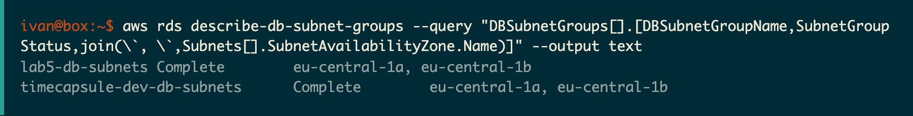
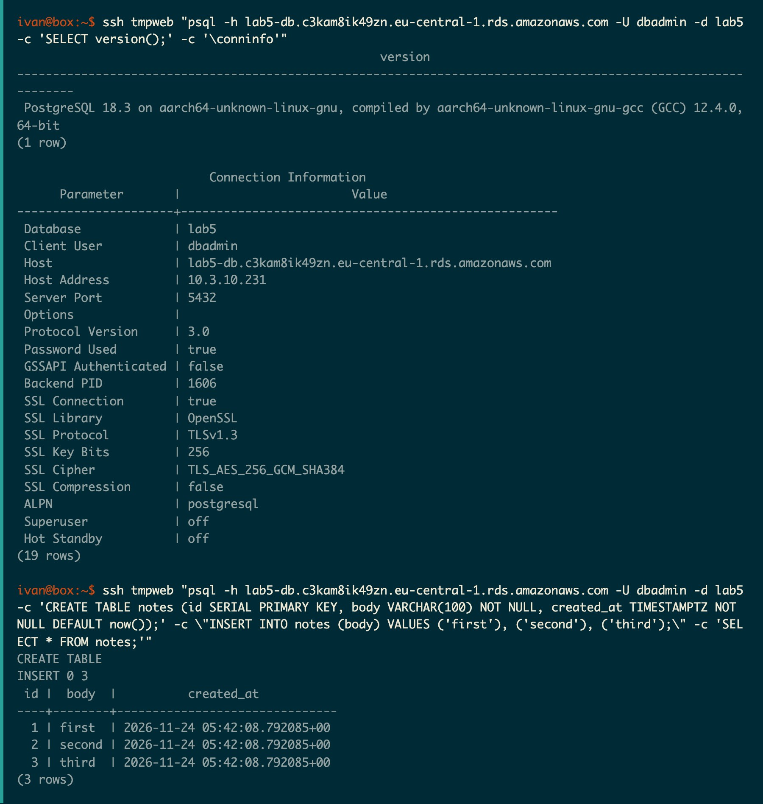
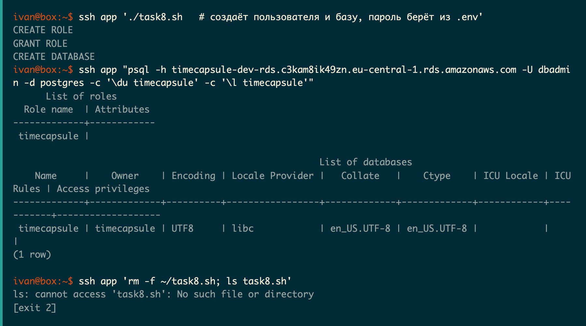
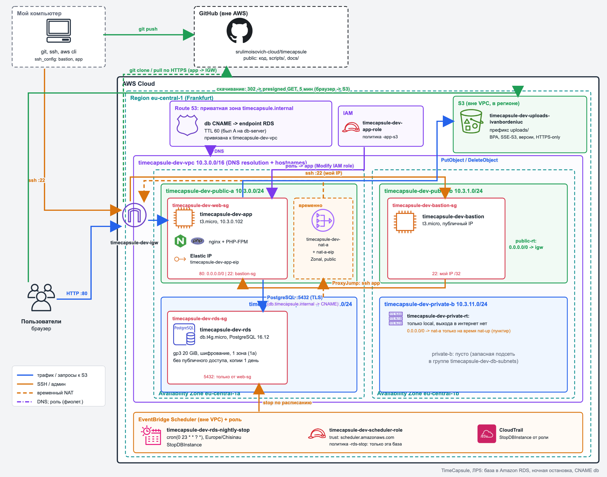

# ЛР5. Облачные базы данных. Amazon RDS (TimeCapsule)

- ФИО: Борденюк Иван (Bordeniuc Ivan)
- Группа: I2402
- Специальность: Informatică
- Уровень: продвинутый (Часть 1 + Часть 2, задания 1-12)
- Репозиторий: https://github.com/srulimoisovich-cloud/timecapsule (публичный)
- ADR: [0004. База в Amazon RDS (Single-AZ), а не на своём сервере](../adr/0004-database-hosting.md)
- Схема: [arch.png](arch.png)
- Прошлые отчёты: [ЛР2](../../README.md), [ЛР3](../lab3/README.md), [ЛР4](../lab4/README.md)

## Коротко

TODO(fill: 4-6 строк: что построил, что вышло, сколько стоило и что осталось). Учебная база `lab5-db` (PostgreSQL 18, Free tier) с репликой и восстановлением на момент времени, потом всё удалено; база приложения `timecapsule-dev-rds` (PostgreSQL 16.12) приняла данные с `db-server`, `db-server` удалён, на ночь базу останавливает EventBridge Scheduler.

Как сняты рисунки. Консоль AWS: настоящие снимки из Chrome (номер аккаунта и домашний IP закрыты). Терминал: настоящий вывод команд, нарисованный из логов. Группы доступа, группы подсетей, `lab5-tmp-web`, политику и роль расписания я создал командами (форма консоли для них ничего нового не показывает), а то, что задание велит показать в консоли (создание базы, реплика, восстановление, расписание), делал в консоли. Команды `psql`, `dig`, `curl` гонял с ноутбука через bastion: `ssh tmpweb '...'`, `ssh app '...'`.

Пароль `dbadmin` обеих баз сгенерировала RDS (`Auto generate password`), он лежит у меня в файле с правами 600 и в `~/.pgpass` на серверах; в отчёт и на рисунки не попадает.

Ограничения Free plan (аккаунт новый): только шаблон `Free tier` (это и есть `Sandbox` из задания), копии максимум 1 день, не больше двух экземпляров RDS одновременно. Где это повлияло, написано в тексте.

Теги на всём: `Name`, `Project=timecapsule`, `Environment=dev`, `Owner=ivanbordeniuc`, `Lab=lab5`, плюс `Team=solo`, `Stack=php`.

| Ресурс | Имя | Значение |
| --- | --- | --- |
| Учебная группа подсетей | `lab5-db-subnets` | `private-a` + `private-b` |
| SG клиента (учебный) | `lab5-clients-sg` | 22 только от `bastion-sg` |
| SG учебной базы | `lab5-rds-sg` | 5432 только от `lab5-clients-sg` |
| Учебный сервер | `lab5-tmp-web` | `t3.micro`, AL2023, `public-b`, `psql` 18 |
| Учебная база | `lab5-db` | PostgreSQL TODO(fill: 18.x), `db.t4g.micro`, `eu-central-1a` |
| Группа подсетей базы | `timecapsule-dev-db-subnets` | `private-a` + `private-b` |
| SG базы | `timecapsule-dev-rds-sg` | 5432 только от `timecapsule-dev-web-sg` |
| База приложения | `timecapsule-dev-rds` | PostgreSQL 16.12, `db.t4g.micro`, `eu-central-1a`, endpoint TODO(fill) |
| Политика расписания | `timecapsule-dev-rds-stop` | только `rds:StopDBInstance` на эту базу |
| Роль расписания | `timecapsule-dev-scheduler-role` | доверие: `scheduler.amazonaws.com` |
| Расписание | `timecapsule-dev-rds-nightly-stop` | `cron(0 23 * * ? *)`, `Europe/Chisinau` |

---

## Часть 1. Базовый уровень

### Задание 1. Размещение и доступ

Группа подсетей `lab5-db-subnets`, SG клиента `lab5-clients-sg` и SG базы `lab5-rds-sg` созданы из CLI, теги те же.

Группы подсетей и их зоны (CLI).

TODO(shot: lab5-subnet-group-console)

Группа `lab5-db-subnets` в консоли RDS: две подсети в `1a` и `1b`.

Правила: в `lab5-rds-sg` единственное правило 5432 с источником `lab5-clients-sg` (в выводе стоит её `sg-...`), в `lab5-clients-sg` ssh только от bastion.

TODO(shot: lab5-rds-sg-rules)

Входящие правила `lab5-rds-sg` в консоли EC2.

ответ: SG источника следует за серверами, а не за адресами: если сервер пересоздать или добавить второй, правило не трогаю, а IP пришлось бы править каждый раз (и он у публичных серверов меняется после остановки). Две подсети нужны, потому что RDS требует группу подсетей минимум из двух зон, даже когда база живёт в одной: так её можно будет восстановить во второй зоне и включить Multi-AZ без пересоздания группы.

### Задание 2. База `lab5-db`

Консоль, `Full configuration`, шаблон `Free tier`.

TODO(shot: lab5-create-1-template)
TODO(shot: lab5-create-2-settings)
TODO(shot: lab5-create-3-storage)
TODO(shot: lab5-create-4-connectivity)
TODO(shot: lab5-create-5-backup)
TODO(shot: lab5-create-6-protection)
TODO(shot: lab5-db-available)

TODO(fill: версия PostgreSQL, ошибка Free plan про 7 дней, если была, и что сделал)

ответ: проверить доступ можно с обеих сторон: с `lab5-tmp-web` соединение идёт (задание 3), с ноутбука и с `app`, который не входит в `lab5-clients-sg`, порт молчит и `psql` упирается в таймаут (рисунок ниже); в SG базы при этом одно правило. Зона `eu-central-1a` потому, что там `public-a`, где живёт `app`: приложение и база в одной зоне не платят за межзонный трафик и не добавляют задержку, а резерва в другой зоне у Single-AZ всё равно нет. `Deletion protection` не даёт удалить экземпляр из консоли, CLI или скриптом по ошибке (сначала надо выключить флаг). От `DROP TABLE` и `DELETE`, от остановки базы, от неудачных миграций, а также от того, кто имеет право выключить флаг, она не защищает.

### Задание 3. Подключение

С `lab5-tmp-web`: `SELECT version()`, `\conninfo`, таблица `notes` и три строки.

TODO(shot: lab5-p1-dig-server)
TODO(shot: lab5-p1-dig-laptop)
TODO(shot: lab5-p1-deny)

`dig` на сервере и на ноутбуке и попытка подключения с постороннего `app`.

TODO(fill: что показали dig на сервере и на ноутбуке)

### Задание 4. Реплика

TODO(shot: lab5-replica-form)
TODO(shot: lab5-replica-available)
TODO(shot: lab5-p1-replica)
TODO(shot: lab5-p1-fourth)
TODO(shot: lab5-replica-lag)

TODO(fill: сколько создавалась, ReplicaLag)

ответ: реплика работает в режиме восстановления (`pg_is_in_recovery() = t`): она только применяет журнал основной базы и принимает чтение, а запись отвергает (`cannot execute INSERT in a read-only transaction`). Реплика для чтения асинхронная, у неё свой endpoint, она читаема и нужна, чтобы разгрузить основную базу; её можно повысить вручную. Резерв Multi-AZ синхронный, читать его нельзя, endpoint у пары один, и при отказе основной AWS переключает на него сама.

### Задание 5. Восстановление после ошибки

TODO(shot: lab5-p1-time)
TODO(shot: lab5-p1-delete)
TODO(shot: lab5-latest-restore-time)
TODO(shot: lab5-pitr-form-time)
TODO(shot: lab5-pitr-form-network)
TODO(shot: lab5-restore-available)
TODO(shot: lab5-p1-restored)

TODO(fill: момент UTC, как пересчитал в часовой пояс формы, сколько ждал Latest restore time)

ответ: реплика повторяет все изменения основной почти сразу, включая ошибочный `DELETE`: через пару секунд таблица пуста и там. Реплика защищает от отказа сервера, а не от ошибки в данных. Восстановление создаёт новую базу, потому что запущенная база живёт на своём диске, а копия собирается из снимка и журнала на новых дисках на нужный момент: так можно сравнить обе, забрать нужные строки и не потерять то, что записано позже, а откатывать работающий экземпляр назад было бы опасно.

### Завершение Части 1

TODO(shot: lab5-databases-after-part1)

TODO(fill: что удалено, список Databases/Snapshots без lab5-, lab5-tmp-web terminated)

---

## Часть 2. Продвинутый уровень

### Задание 6. База приложения

Группа подсетей `timecapsule-dev-db-subnets` и SG `timecapsule-dev-rds-sg` создал командами, базу формой консоли, после удаления учебных (лимит двух экземпляров).

TODO(shot: lab5-app-db-form-1)
TODO(shot: lab5-app-db-form-2)
TODO(shot: lab5-app-db-connectivity)

ответ: для боевой системы взял бы Multi-AZ (автопереключение, без потери данных), копии на 14-35 дней и снимок перед миграциями, класс без кредитов процессора (`db.m7g.large` или `t4g.small` в режиме unlimited), автоувеличение диска с потолком, Performance Insights, журналы PostgreSQL в CloudWatch и тревоги на CPU, память, место и число соединений. Пароль мастера держал бы в Secrets Manager с ротацией, а ночную остановку отключил бы: на проде база должна быть всегда.

### Задание 7. Ночная остановка

Политику и роль создал командами (файлы в `lab05/files`: политика с одним действием и одним ARN, доверие с `aws:SourceAccount`).

TODO(shot: lab5-scheduler-policy)
TODO(shot: lab5-scheduler-role-trust)
TODO(shot: lab5-schedule-cron-test)
TODO(shot: lab5-schedule-target)
TODO(shot: lab5-schedule-role)
TODO(shot: lab5-schedule-created)
TODO(shot: lab5-schedule-stopped-event)

TODO(fill: время теста, когда остановилась база, событие в Logs & events, затем выражение 0 23 * * ? *, старт базы)

ответ: расписание не вхожий в мою учётную запись сервис, действует только от роли: у него нет моих прав и не должно быть. Отдельная роль даёт именно то, что нужно, и ничего сверх (принцип наименьших прав), а брать её на себя может только `scheduler.amazonaws.com` из моего аккаунта. Роль остановит ровно одну базу, потому что в политике один action `rds:StopDBInstance` и один ARN `...:db:timecapsule-dev-rds`, без `*`: другую базу, запуск или удаление расписание не тронет, даже если его подменят.

### Задание 8. Пользователь и база

TODO(fill: как задан пароль, `GRANT`, `CREATE DATABASE`)

ответ: `dbadmin` может почти всё (создавать роли и базы, читать любую базу экземпляра), и пароль мастера нужен мне, а не коду. Если приложение работает под ним, одна SQL-инъекция или утёкший `.env` отдают весь экземпляр. Пользователь `timecapsule` владеет только своей базой, не может создавать роли и ходить в чужие базы, а его пароль можно менять отдельно, не трогая мастера.

### Задание 9. Перенос данных

TODO(shot: lab5-p2-migrate)

ответ приложения не открывал от выгрузки до переключения: TODO(fill: количества users / capsules в обеих базах совпали, дамп удалён).

### Задание 10. Переключение

TODO(shot: lab5-p2-dns)
TODO(shot: lab5-p2-tls)
TODO(shot: lab5-p2-capsules)
TODO(shot: lab5-instances-no-db)

TODO(fill: /health, новая капсула в RDS, db-server stop -> приложение работает -> terminate)

ответ: `DB_HOST` не менялся, потому что приложение ходит на имя `db.timecapsule.internal`, а я поменял только то, что за именем стоит (A на `db-server` на CNAME на endpoint). К AWS перешли ОС и минорные патчи PostgreSQL, ежедневные копии и журнал для восстановления на момент времени, диск и железо, замена экземпляра при поломке железа. За мной остались схема и запросы, пользователи и пароли, сеть (SG, подсети), выбор срока копий, мониторинг, мажорные обновления, остановка и расходы.

### Задание 11. Обслуживание

TODO(shot: lab5-reboot-health)
TODO(shot: lab5-rds-events)
TODO(fill: Reboot, /health во время перезагрузки, Stop/Start, приложение при остановленной базе, endpoint после старта, повторный Stop -> ошибка)

### Задание 12. CloudTrail

TODO(shot: lab5-cloudtrail-stop)

TODO(fill: событие StopDBInstance от assumed-role/timecapsule-dev-scheduler-role)

### Схема и ADR

Схема ЛР4 плюс RDS в приватной подсети (вторая подсеть в группе пустая), Scheduler с ролью и CNAME в зоне `timecapsule.internal`.

Решение записано в [ADR-0004](../adr/0004-database-hosting.md): PostgreSQL на EC2, RDS Single-AZ, Multi-AZ и Aurora, выбран Single-AZ.

---

## Грабли

TODO(fill: 3-6 пунктов по факту; уже известно: Free plan: 1 день копий и 2 экземпляра RDS; реплику нельзя создать, пока основная в backing-up; стоп RDS около 8 минут, старт около 5; pg 16.12 в RDS против 16.16 на db-server, дамп всё равно загрузился)

## Q&A (устные вопросы)

1. Запрос из браузера идёт на Elastic IP `app`: Internet Gateway, `timecapsule-dev-web-sg` пускает 80 из интернета, nginx, PHP-FPM. PHP разрешает `db.timecapsule.internal` через резолвер VPC: приватная зона отдаёт CNAME на endpoint, а он резолвится в приватный адрес в `private-a`. Пакет на 5432 идёт по маршруту `local`, NACL подсетей его пропускает, `timecapsule-dev-rds-sg` пускает только источник `timecapsule-dev-web-sg`; дальше TLS и вход под `timecapsule` в базу `timecapsule`.
2. Репликация повторяет текущие изменения на другой экземпляр (в том числе ошибочные), поэтому помогает при отказе сервера и для чтения, но не откатывает данные. Резервная копия (снимок плюс журнал) хранит прошлые состояния, из неё можно вернуться на момент до ошибки, но это новая база и минуты ожидания. Нужны обе вещи, одна не заменяет другую.
3. Сейчас отказ `1a` переживается вручную: `Restore to point in time` в `eu-central-1b` (подсеть там есть в группе), CNAME `db` на новый endpoint и приложение из `public-b`; десятки минут простоя и до 5 минут потерянных записей, почти бесплатно. Автоматически это даёт Multi-AZ: резерв в `1b`, переключение за минуту-две без потерь, но экземпляр и диск стоят вдвое больше (около 0,038 USD/ч и 5,2 USD/мес).
4. Ночное расписание: каждый день в 23:00 по Кишинёву `StopDBInstance` от роли с правом только на эту базу. Если AWS запустит базу через 7 дней остановки, она проработает не дольше чем до ближайших 23:00. Дополнительно останавливаю базу руками после занятия, а бюджет `ZeroSpend` напишет, если что-то пойдёт не так.

## Итог

TODO(fill: что остановлено и что платное осталось: `timecapsule-dev-rds` остановлена, расписание включено; платят диск RDS, Elastic IP `app`, зона Route 53, EBS)

## Ссылки

- [Amazon RDS: Working with DB instance read replicas](https://docs.aws.amazon.com/AmazonRDS/latest/UserGuide/USER_ReadRepl.html)
- [Restoring a DB instance to a specified time](https://docs.aws.amazon.com/AmazonRDS/latest/UserGuide/USER_PIT.html)
- [Stopping an Amazon RDS DB instance temporarily](https://docs.aws.amazon.com/AmazonRDS/latest/UserGuide/USER_StopInstance.html)
- [EventBridge Scheduler: universal targets](https://docs.aws.amazon.com/scheduler/latest/UserGuide/managing-targets-universal.html)
